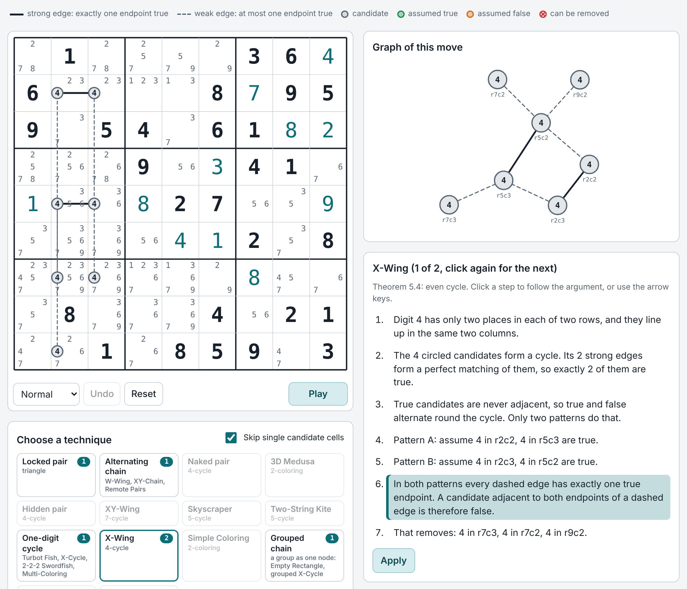
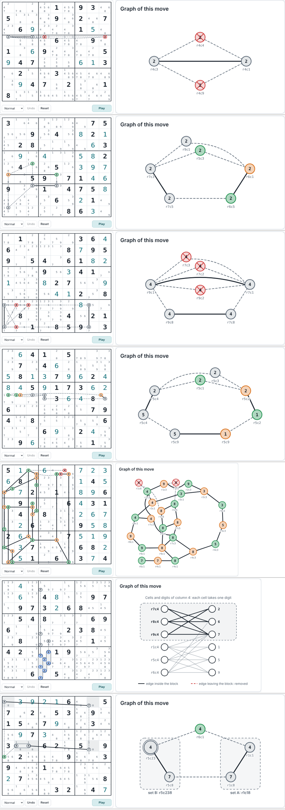

# Solving Sudoku Using Graph Coloring

This project describes common sudoku strategies (X-Wing, XY-Wing, Skyscraper, Simple Coloring and others) as 2-colorings of a graph of candidates, with true and false as the two colors.

**Try it:** [the solver](https://hyejunshin.github.io/sudoku-graph-theory/) · **Read it:** [the write-up](https://hyejunshin.github.io/sudoku-graph-theory/writeup/)

## The idea

A **candidate** is a digit that could still go in a cell. In each empty cell exactly one candidate is the real answer: call it **true** and the rest **false**. Solving means proving candidates false and removing them.

Each candidate is a node. Two candidates that can't both be true are joined by an edge. The edge is **strong** when exactly one of them must be true, and **weak** when at most one can be.

Assume one candidate is true and color the graph in two colors, true and false. A true node makes all its neighbors false. A false node makes its strong neighbors true. If two adjacent nodes are both true, the assumption was false, and that candidate is removed.

## Moves as graphs

*Left: the move on the board. Right: the same nodes and edges, with a group of candidates as one node.*

## Step by step

**1. Edges.** If a candidate is true, every node adjacent to it is false. If a candidate is false and one of its edges is strong, the other endpoint is true. Each strategy is a sequence of these two steps, so on the graph it is a path or a cycle.

**2. True and false as two colors.** Adjacent nodes are never both true. Around a cycle the colors alternate only if the cycle is even.

**3. Strong edges form a bipartite graph.** The two endpoints of a strong edge always have different colors, so each component has two colorings: one class true, the other false. A node adjacent to both classes is false. This is Simple Coloring and 3D Medusa.

**4. Odd cycles.** An odd cycle has an edge with both endpoints false, and that edge is weak. If the strong edges of an odd cycle contain a perfect matching of all its nodes but one, that node is false. This covers Skyscraper, Two-String Kite, Turbot Fish and XY-Wing.

**5. Even cycles.** If the strong edges of an even cycle contain a perfect matching of it, every edge of the cycle has exactly one true endpoint. A node adjacent to both endpoints of such an edge is false. This covers X-Wing, naked pair and hidden pair.

Only step 3 is about a bipartite graph. Steps 4 and 5 apply the 2-coloring to single cycles in the full candidate graph, which is not bipartite.

## Extensions

Some moves involve more than two candidates at a time. The write-up proves these extensions:

| Extension | Covers |
| --- | --- |
| **A group as one node**: cells of one box in one row or column, true when one of them holds the digit | Locked triple, Grouped chain (Empty Rectangle, grouped X-Cycle) |
| **Clauses u ∨ v from counting**: in a set of cells with one digit too many, two digits cannot both be missing | XYZ-Wing, almost-locked sets (ALS-XZ, WXYZ-Wing, chains, basic Sue de Coq), finned fish |
| **Counting over constraint sets** (Theorem 7.5): k sets covered by k sets. The solver draws these as cells against digits (or rows against columns), the second bipartite graph | Triples and quads, Swordfish, Jellyfish |
| **One more fact**: the puzzle has exactly one solution | Unique rectangle |
| **Last resort**: suppose a candidate is true and follow the single candidate cells to a contradiction | Trial and error |

In 2,500 random puzzles, about half were finished by single candidate cells alone, almost all the rest by cycles and colorings, and about 0.7% still needed a guess. With the guess, every puzzle can be finished.

## Using the solver

- Pick an example, press **Random**, or paste 81 characters (row by row, `.` or `0` for empty cells). Only proper sudokus load: one solution, no repeated digit.
- **Play** solves the puzzle step by step. Pick a speed, or *Moves only* to skip the reasoning. Click the board to pause.
- **Choose a technique** to see one move: the steps beside it, the board marking true and false, and the **Graph of this move**. Click a step, or use the arrow keys. **Apply** carries the move out.
- **Skip single candidate cells** fills cells with only one option left. Switch it off, or press **Random easy**, to watch them one by one.
- Click a candidate to see its edges, or pick a digit to see its strong edges, each chain colored assumed true and assumed false.

Open `index.html` directly; it needs no server.

## Code

GitHub Pages serves this repository from `main`: the solver is the [home page](https://hyejunshin.github.io/sudoku-graph-theory/), the write-up is at [`/writeup/`](https://hyejunshin.github.io/sudoku-graph-theory/writeup/). The source, tests and proof checks are described in [`src/README.md`](src/README.md).
