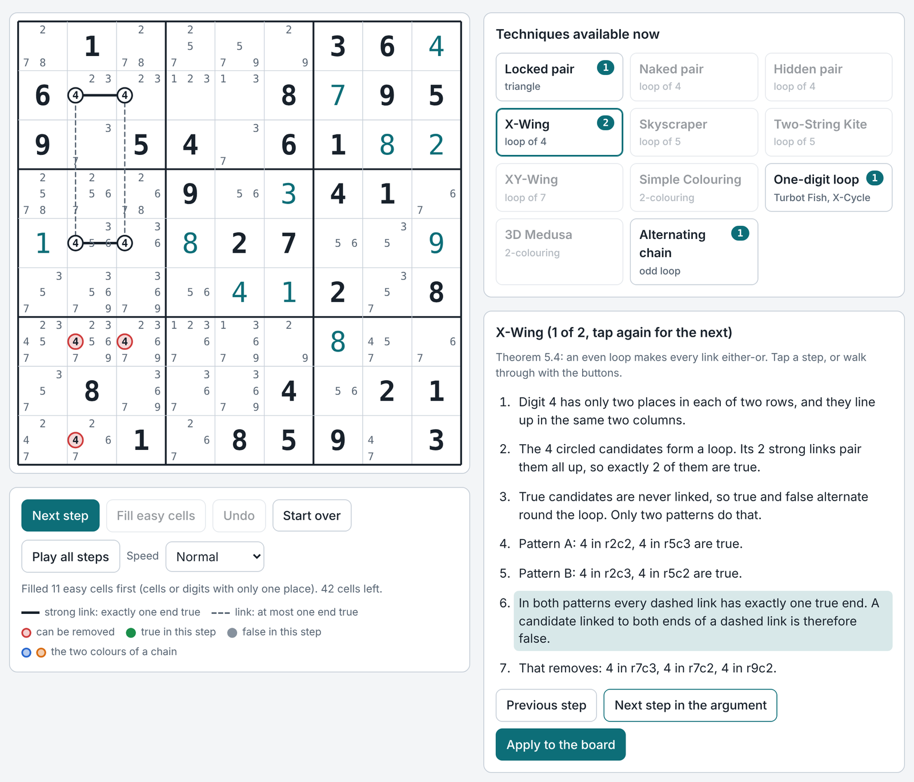
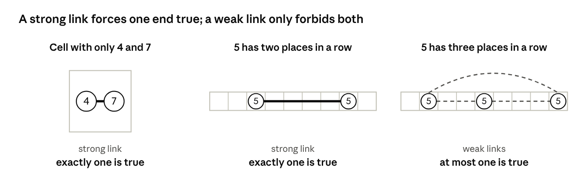

# Why Advanced Sudoku Strategies Work

Advanced sudoku strategies (X-Wing, XY-Wing, Skyscraper, Simple Colouring and others) are usually memorised as separate tricks. This project shows they all come down to one question from the theory of **bipartite graphs**: can this loop be coloured with two colours? When it can, true and false alternate round it. When it cannot, something has to give, and that tells you which candidate to remove.

**Try it:** [Sudoku Loop Finder](https://hyejunshin.github.io/sudoku-graph-theory/) · **Read it:** [the write-up](https://hyejunshin.github.io/sudoku-graph-theory/writeup/)

*The Loop Finder explaining an X-Wing on a real puzzle. Click the picture to open it.*

## First: what a candidate is

When a cell is still empty, solvers write in it, in small digits, every digit that could still go there. Each of these is a **candidate**: one digit in one cell. In the picture above, the top-left cell has three candidates, 2, 7 and 8, because its row, column and box already contain every other digit.

In each empty cell exactly one candidate is the real answer. Call that one **true** and the rest **false**. Solving a sudoku means working out which candidates are false and removing them until one is left in every cell. Every strategy below is a way of proving that some candidate is false.

## The idea

**1. Candidates are dots, and every line between them is a rule.** Draw each candidate as a dot. The rules of sudoku allow one digit per cell, and each digit once per row, column and box. So some pairs of candidates can never both be true: two digits in the same cell, or the same digit twice in a row, column or box. Join every such pair with a line, called a *link*. A link says "not both".

Why draw the lines? Because what you learn about one candidate travels along them. If a candidate is true, everything linked to it is false. Some links also work the other way: a link is *strong* when its two candidates are the only ones left in their cell, or the only places left for that digit in a row, column or box. Then exactly one of the two is true, so if one is false the other is true. Every strategy is a chain of these steps, and on the graph a chain of steps is simply a path or a loop you can see.

**2. True and false are two colours.** Colour every candidate by whether it is true or false in the solution. Linked candidates are never both true, so round a loop the colours try to alternate. An even loop can do that. An odd loop cannot.

**3. Strong links form a bipartite graph.** Across a strong link the two colours always differ, so the strong links alone can always be two-coloured. Each connected piece has only two colourings: one colour is all true and the other all false. A candidate linked to candidates of both colours can be removed, since one of those colours is true. That is Simple Colouring and 3D Medusa.

**4. Odd loops break the colouring, and that removes candidates.** On an odd loop the colours cannot alternate all the way round, so some link has both ends false, and it cannot be a strong one. When the strong links pair up every candidate but one, that candidate must be false. Skyscraper, Two-String Kite, Turbot Fish and XY-Wing are all this picture:

**5. Even loops keep the colouring.** When the strong links pair up every candidate on an even loop, true and false alternate perfectly, so every link on it has exactly one true end. Anything linked to both ends of such a link can be removed. That is X-Wing, naked pair and hidden pair.

To be exact about the claim: only step 3 uses a bipartite graph as such. Steps 4 and 5 apply the same two-colour fact to single loops in the graph of all links, and that graph is not bipartite. Its odd loops are exactly what step 4 exploits.

The [write-up](https://hyejunshin.github.io/sudoku-graph-theory/writeup/) proves each step, shows where the method stops, and has 24 pictures like these.

## The Loop Finder

Open `index.html` directly; it needs no server and no build step.

- Paste a puzzle as 81 characters, row by row, with `.` or `0` for empty cells (spaces and line breaks are fine). Or pick one of the built-in examples.
- Only proper sudokus load: no digit twice in a row, column or box, and exactly one solution. Anything else is refused with the reason.
- **Next step** shows the simplest move available. Each move lists the chain of forced steps behind it, and the board marks candidates true or false as you walk through.
- **Play all steps** solves the puzzle by itself, one move after another. Each candidate that goes is circled in red, struck through and then fades from the board. Choose a speed, or pick *Moves only* to skip the reasoning and just watch the loops and removals. Tap the board to pause.
- Tap any candidate on the board to see everything it is linked to. Pick a digit to see its strong links coloured in two colours.

Techniques it finds: locked pair, naked pair, hidden pair, X-Wing, Skyscraper, Two-String Kite, XY-Wing, Simple Colouring, one-digit odd loops (Turbot Fish, X-Cycle), 3D Medusa, and general alternating chains (which include W-Wing and XY-Chain).

It only knows techniques that follow from links. When a puzzle needs something else, such as a naked triple or a larger fish, it says so. The write-up proves that this limit is real.

## The website

GitHub Pages serves this repository from the root of the main branch: the Loop Finder is the [home page](https://hyejunshin.github.io/sudoku-graph-theory/) and the write-up is at [`/writeup/`](https://hyejunshin.github.io/sudoku-graph-theory/writeup/). Every push to `main` updates the site.

## Code

The source, the tests and the proof checks are described in [`src/README.md`](src/README.md).
