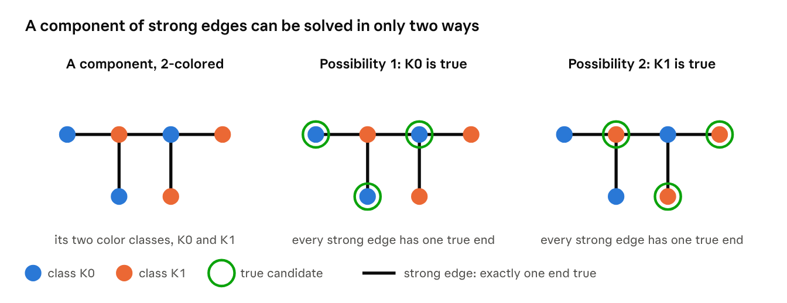

# Why Advanced Sudoku Strategies Work

Advanced sudoku strategies (X-Wing, XY-Wing, Skyscraper, Simple Colouring and others) are usually memorised as separate tricks. This project shows they all come from one fact about **bipartite graphs**: a graph can be coloured with two colours exactly when it has no odd loop.

**Try it:** [Sudoku Loop Finder](https://hyejunshin.github.io/sudoku-graph-theory/) · **Read it:** [the write-up](https://hyejunshin.github.io/sudoku-graph-theory/writeup/)

*The Loop Finder explaining an X-Wing on a real puzzle. Click the picture to open it.*

## The idea

**1. Pencil marks are dots, and the rules are links.** Two pencil marks are linked when the rules forbid both from being true: two digits in one cell, or one digit twice in a row, column or box. A link is *strong* when exactly one of the two must be true.

**2. True and false are two colours.** Colour every pencil mark by whether it is true or false in the solution. Linked marks are never both true, so round a loop the colours try to alternate. An even loop can do that. An odd loop cannot.

**3. Strong links form a bipartite graph.** Across a strong link the two colours always differ, so the strong links alone can always be two-coloured. Each connected piece has only two colourings: one colour is all true and the other all false. A pencil mark linked to marks of both colours can be removed, since one of those colours is true. That is Simple Colouring and 3D Medusa.

**4. Odd loops break the colouring, and that removes pencil marks.** On an odd loop the colours cannot alternate all the way round, so some link has both ends false, and it cannot be a strong one. When the strong links pair up every mark but one, that mark must be false. Skyscraper, Two-String Kite, Turbot Fish and XY-Wing are all this picture:

**5. Even loops keep the colouring.** When the strong links pair up every mark on an even loop, true and false alternate perfectly, so every link on it has exactly one true end. Anything linked to both ends of such a link can be removed. That is X-Wing, naked pair and hidden pair.

The [write-up](https://hyejunshin.github.io/sudoku-graph-theory/writeup/) proves each step, shows where the method stops, and has 24 pictures like these.

## The Loop Finder

Open `index.html` directly; it needs no server and no build step.

- Paste a puzzle as 81 characters, row by row, with `.` or `0` for empty cells (spaces and line breaks are fine). Or pick one of the built-in examples.
- Only proper sudokus load: no digit twice in a row, column or box, and exactly one solution. Anything else is refused with the reason.
- **Next step** shows the simplest move available. Each move lists the chain of forced steps behind it, and the board marks candidates true or false as you walk through.
- Tap any pencil mark to see everything it is linked to. Pick a digit to see its strong links coloured in two colours.

Techniques it finds: locked pair, naked pair, hidden pair, X-Wing, Skyscraper, Two-String Kite, XY-Wing, Simple Colouring, one-digit odd loops (Turbot Fish, X-Cycle), 3D Medusa, and general alternating chains (which include W-Wing and XY-Chain).

It only knows techniques that follow from links. When a puzzle needs something else, such as a naked triple or a larger fish, it says so. The write-up proves that this limit is real.

## The website

GitHub Pages serves this repository from the root of the main branch: the Loop Finder is the [home page](https://hyejunshin.github.io/sudoku-graph-theory/) and the write-up is at [`/writeup/`](https://hyejunshin.github.io/sudoku-graph-theory/writeup/). Every push to `main` updates the site.

## Code

The source, the tests and the proof checks are described in [`src/README.md`](src/README.md).
