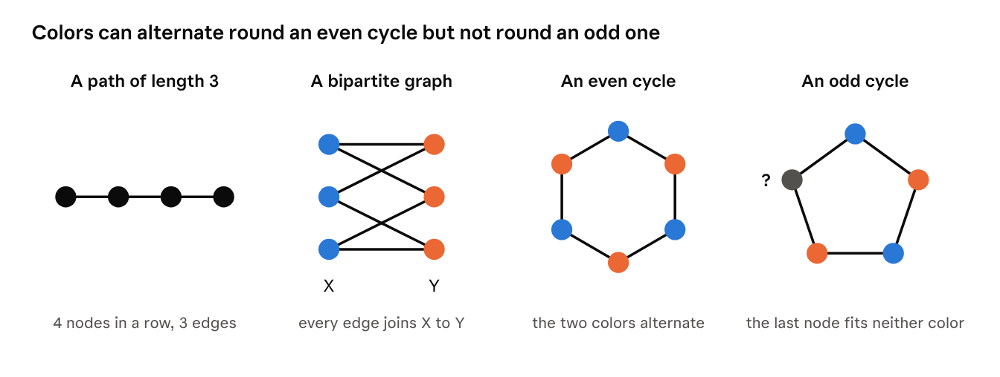
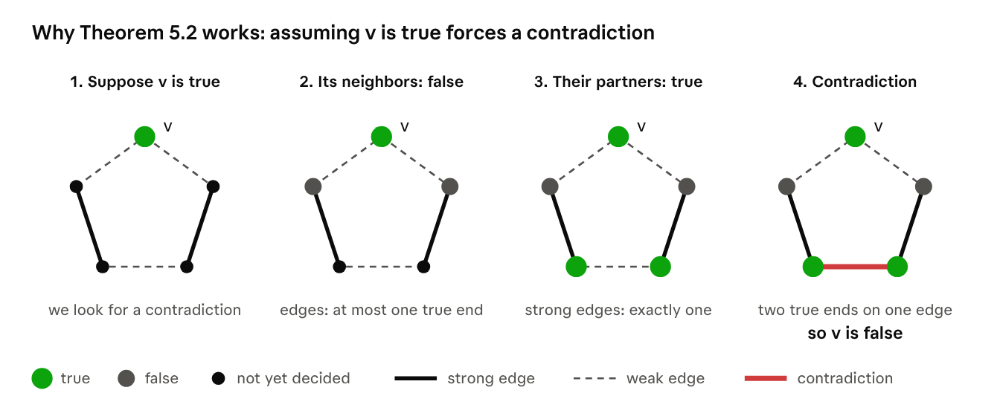

# Why Advanced Sudoku Strategies Work

Advanced sudoku strategies (X-Wing, XY-Wing, Skyscraper, Simple Coloring and others) are usually memorized as separate tricks. This project shows they are one idea from the theory of **bipartite graphs**.

The idea: take a loop of candidates (digits still possible in a cell) in which each one conflicts with the next, so the two cannot both be true. Now try to mark them true, false, true, false all the way round.

- **On a loop with an even number of candidates, the marking fits.** When the puzzle forces it, every neighboring pair on the loop holds exactly one true candidate. So any other candidate that conflicts with both members of a pair must be false.
- **On a loop with an odd number, the marking cannot fit.** Somewhere on the loop two neighbors are both false. Working out where that has to happen shows which candidate is false.

Marking things with two labels so that neighbors always differ is called *two-coloring*, and a graph where that is possible is called *bipartite*.

**Try it:** [Solving Sudoku Using Graph Coloring](https://hyejunshin.github.io/sudoku-graph-theory/) · **Read it:** [the write-up](https://hyejunshin.github.io/sudoku-graph-theory/writeup/)

*The solver explaining an X-Wing on a real puzzle. Click the picture to open it.*

## Every move is a small graph

*Left: the move on the board. Right: the same dots and links drawn as a graph, with a group of candidates as one dot. From the top: Locked pair, Skyscraper, X-Wing, XY-Wing, 3D Medusa, naked triple, almost-locked sets.*

## First: what a candidate is

When a cell is still empty, solvers write in it, in small digits, every digit that could still go there. Each of these is a **candidate**: one digit in one cell. In the picture above, the top-left cell has three candidates, 2, 7 and 8, because its row, column and box already contain every other digit.

In each empty cell exactly one candidate is the real answer. Call that one **true** and the rest **false**. Solving a sudoku means working out which candidates are false and removing them until one is left in every cell. Every strategy below is a way of proving that some candidate is false.

## The idea, step by step

**1. Candidates are dots, and every line between them is a rule.** Draw each candidate as a dot. The rules of sudoku allow one digit per cell, and each digit once per row, column and box. So some pairs of candidates can never both be true: two digits in the same cell, or the same digit twice in a row, column or box. Join every such pair with a line, called a *link*. A link says "not both".

Why draw the lines? Because what you learn about one candidate travels along them. If a candidate is true, everything linked to it is false. Some links also work the other way: a link is *strong* when its two candidates are the only ones left in their cell, or the only places left for that digit in a row, column or box. Then exactly one of the two is true, so if one is false the other is true. Every strategy is a chain of these steps, and on the graph a chain of steps is simply a path or a loop you can see.

**2. True and false are two colors.** Color every candidate by whether it is true or false in the solution. Linked candidates are never both true, so round a loop the colors try to alternate. An even loop can do that. An odd loop cannot.

**3. Strong links form a bipartite graph.** Across a strong link the two colors always differ, so the strong links alone can always be two-colored. Each connected piece has only two colorings: one color is all true and the other all false. A candidate linked to candidates of both colors can be removed, since one of those colors is true. That is Simple Coloring and 3D Medusa.

**4. Odd loops break the coloring, and that removes candidates.** On an odd loop the colors cannot alternate all the way round, so some link has both ends false, and it cannot be a strong one. When the strong links pair up every candidate but one, that candidate must be false. Skyscraper, Two-String Kite, Turbot Fish and XY-Wing are all this picture:

**5. Even loops keep the coloring.** When the strong links pair up every candidate on an even loop, true and false alternate perfectly, so every link on it has exactly one true end. Anything linked to both ends of such a link can be removed. That is X-Wing, naked pair and hidden pair.

To be exact about the claim: only step 3 uses a bipartite graph as such. Steps 4 and 5 apply the same two-color fact to single loops in the graph of all links, and that graph is not bipartite. Its odd loops are exactly what step 4 exploits.

The [write-up](https://hyejunshin.github.io/sudoku-graph-theory/writeup/) proves each step, shows where the method stops, and has 24 pictures like these.

## The solver

Open `index.html` directly; it needs no server and no build step.

- Paste a puzzle as 81 characters, row by row, with `.` or `0` for empty cells (spaces and line breaks are fine). Or pick one of the built-in examples.
- Choose **Random** from the list for a fresh puzzle each time. Every one has exactly one solution, needs at least one of the techniques, and can be finished without a guess.
- **Skip single candidate cells** is on by default: cells with one candidate left, and digits with one place left, are filled without being shown. Switch it off to start from every candidate and have each such cell appear as its own step. **Random (single cells only)** gives a puzzle those cells alone finish, with the switch off so there is something to watch.
- Only proper sudokus load: no digit twice in a row, column or box, and exactly one solution. Anything else is refused with the reason.
- Choose a technique to see a move of that kind. Each move lists the chain of forced steps behind it; tap a step (or use the arrow keys) and the board marks candidates true or false. **Apply** carries the move out.
- **Play** solves the puzzle by itself, one move after another. Each candidate that goes is circled in red, struck through and then fades from the board. Choose a speed, or pick *Moves* to skip the reasoning and just watch the loops and removals. Tap the board to pause.
- **Graph of this move**: beside the board (below the play controls on a phone) the current move is redrawn as a plain graph, with the dots spread out and a group shown as one dot. It carries the same colors as the board and steps along with it, so the move reads as what it is: a two-coloring problem.
- Tap any candidate on the board to see everything it is linked to, or pick a digit under the techniques to see its strong links. Pick a digit to see its strong links colored in two colors.

Techniques it finds: locked pair, naked pair, hidden pair, X-Wing, Skyscraper, Two-String Kite, XY-Wing, Simple Coloring, one-digit odd loops (Turbot Fish, X-Cycle), 3D Medusa, and general alternating chains (which include W-Wing and XY-Chain).

It only knows techniques that follow from links. When a puzzle needs something else, such as a naked triple or a larger fish, it says so. The write-up proves that this limit is real.

## Beyond links

Links join two candidates at a time, so some puzzles cannot be finished by loops and colorings alone. A test on 2,000 random puzzles gave:

| Outcome | Puzzles |
| --- | --- |
| Solved by single candidate cells alone | 971 |
| Solved by the link techniques | 965 |
| Stuck: no link argument exists | 64 (3.2%) |

A search for everything links can prove, on a smaller sample, solved nothing the solver had missed. So the stuck puzzles are a limit of reasoning about two candidates at a time, not of the tool.

**Groups extend the loop rule.** Let a dot stand for a group: two or three cells of one box that share a row or column, true when one of them holds the digit. The same odd-loop argument then covers **Locked triple** and **Grouped chain** (Empty Rectangle, grouped X-Cycle). These sit with the other loop techniques. The write-up proves this in its last step.

**Counting across sets.** Triples, quads and bigger fish need a rule about whole sets, not pairs. The write-up proves it as the *sets rule*: count the true candidates of k sets twice. It is the counting behind Hall's theorem on a second bipartite graph, where sets are dots and candidates are edges, and X-Wing and the pairs are its smallest case.

- **Triples and quads**, naked or hidden: k cells of a unit against the k digits they hold.
- **Bigger fish** (Swordfish, Jellyfish): one digit in k rows against k columns.

**A counted link.** In an **XYZ-Wing** one of three candidates must be true, which a short count shows. With the candidate it removes, that closes a triangle, the same shape as the Locked pair. It sits with the loops.

**More counted links.** Inside an **almost-locked set** (a few cells with one digit too many), two digits cannot both be missing. That gives counted links, so loops can run through such sets: ALS-XZ, WXYZ-Wing, chains of almost-locked sets, and the two-link case that includes the basic Sue de Coq. **Finned fish** are a triangle of the same kind. These two searches are slower, so they run only when nothing earlier applies. In 2,500 random puzzles they cut the share needing a guess to 0.7%.

**One more fact.** A **unique rectangle** is an even loop that could be colored both ways with nothing to decide between them. It adds the assumption that a proper sudoku has one solution.

**Last resort.** **Trial and error**: suppose a candidate is true, fill the single candidate cells that follow, and reach a contradiction. It is not a loop, a coloring or a count, and it is offered only when nothing else applies.

In a test on 6,000 random puzzles with all of these, 106 used a group step (locked triple or grouped chain), 34 a naked triple, 1 a unique rectangle, and 75 (1.2%) still needed a guess. Bigger fish and XYZ-Wing were never needed: they exist, but random puzzles almost never require them. With the guess every puzzle can be finished. The last entries of the example list show these steps.

## The website

GitHub Pages serves this repository from the root of the main branch: the solver is the [home page](https://hyejunshin.github.io/sudoku-graph-theory/) and the write-up is at [`/writeup/`](https://hyejunshin.github.io/sudoku-graph-theory/writeup/). Every push to `main` updates the site.

## Code

The source, the tests and the proof checks are described in [`src/README.md`](src/README.md).
