# Sudoku Strategies as Graph Coloring

2026-11-15 · Hyejun Shin

This write-up shows that common sudoku strategies (X-Wing, XY-Wing, Skyscraper, Simple Coloring and others) follow from Lemma 4.1, a counting identity for cycles in a graph whose nodes are the candidates. Sections 2 to 5 give the definitions and proofs. Section 6 applies them to each strategy. Section 7 covers what the lemma does not reach and how it extends. The solver page [Solving Sudoku Using Graph Coloring](../index.html) applies the same rules to real puzzles.

## 1. Summary

1.  A *candidate* is a triple (r, c, d), the proposition that the cell in row r and column c contains digit d. The candidates that have not been eliminated form a set P.

2.  Two candidates are *adjacent*, joined by an *edge*, if they cannot both be true: two digits in one cell, or one digit in two cells of the same row, column or box. A *solution* assigns true to exactly one candidate of each cell, and of each digit in each row, column and box, and false to the others.

3.  An edge uv is *strong* if a cell has only the candidates u and v, or a digit has only the places u and v in a row, column or box. Then exactly one of u and v is true. Every other edge is *weak*; at most one of its endpoints is true.

4.  **Lemma 4.1.** Let C be a cycle of k candidates, t of them true. The number of edges of C with both endpoints false is k − 2t. So an odd cycle has at least one edge with both endpoints false, and that edge is weak.

The results:

- The strong edges can be 2-colored, true and false (Theorem 5.1).

- If the strong edges of an odd cycle contain a perfect matching of all its candidates but one, that candidate is false (Theorem 5.2). A similar condition makes a candidate true (Theorem 5.3).

- If the strong edges of an even cycle contain a perfect matching of the cycle, every edge of the cycle has exactly one true endpoint (Theorem 5.4).

The strategies are not new; Section 8 lists sources. This write-up gives one proof for all of them.

## 2. Graphs and 2-colorings

A *graph* is a set of nodes with edges joining some pairs. Two nodes joined by an edge are *adjacent*, or *neighbors*. All graphs here are finite, and no edge joins a node to itself.

- A *path* of length n is a sequence of n + 1 different nodes, each adjacent to the next.

- A *cycle* of length k ≥ 3 is k different nodes v1, ..., vk in which each is adjacent to the next, and vk is adjacent to v1. It is *odd* or *even* as k is.

- A graph is *connected* if a path joins any two nodes. Its connected parts are its *components*. The *distance* d(u, v) is the length of a shortest path from u to v.

- A *2-coloring* gives each node color 0 or 1 so that the two endpoints of every edge differ.

- A graph is *bipartite* if its nodes split into two sets X and Y with every edge between the sets. This is the same as having a 2-coloring: X is color 0 and Y is color 1.


*Figure 1. paths, bipartite graphs, even and odd cycles*

Around a cycle the colors alternate, which requires an even number of nodes. In the odd cycle in Figure 1, the gray node has a neighbor of each color.

**Theorem 2.1 (König).** A graph is bipartite if and only if it has no odd cycle.

*Proof, first half.* Suppose a 2-coloring exists and v1, ..., vk is a cycle. Neighbors differ, so vi has the color of v1 exactly when i is odd. Since vk is adjacent to v1, their colors differ, so k is even.

*Proof, second half.* Suppose there is no odd cycle. No edge joins two components, so each component can be colored separately. Assume the graph is connected and fix a node r. Two facts about distances from r are needed.

- (D1) Adjacent nodes have distances from r that differ by at most 1.

- (D2) On a shortest path from r, the node in position i is at distance i.

Both use this: a *walk* is like a path but may repeat nodes, and a walk of length n from x to y shows d(x, y) ≤ n, because removing the part between two visits to the same node, until no node repeats, gives a path no longer than the walk.

For (D1), a shortest path to u followed by v is a walk of length d(r, u) + 1, so d(r, v) ≤ d(r, u) + 1. Swapping u and v gives the other direction. For (D2), the first i steps form a path, so the distance is at most i. A shorter path to that node, followed by the rest of the path, would be a walk to the end shorter than a shortest path.

1.  Color each node by its distance from r: color 0 for even distance, color 1 for odd.

2.  Suppose an edge uv has both endpoints the same color. By (D1) their distances differ by at most 1. They have the same parity, so they are equal. Call the distance n.

3.  Take shortest paths A from r to u and B from r to v. Let w be the last node of A that is also on B, at distance j. By (D2), w is in position j on both paths.

4.  If w were u, then u would be on B at distance n, which is the end of B, so u = v. The two endpoints of an edge differ, so w is not u. Likewise w is not v. So j \< n.

5.  After w the two paths each have n − j ≥ 1 edges and share no node. With the edge uv they form a cycle of 2(n − j) + 1 edges, which is odd. This contradicts the assumption.

So no edge has both endpoints the same color, and the coloring is a 2-coloring. ∎


*Figure 2. Theorem 2.1, second half · three steps*

In Figure 2, w is the last common node of the two paths. The two branches after w have equal length, so with uv they form an odd cycle.

**Corollary 2.2.** A connected bipartite graph has exactly two 2-colorings, and each is the other with the colors swapped.

*Proof.* Fix a node r. Along a shortest path from r the colors alternate, so the color of r determines the color of every node. Both choices for r give a 2-coloring: one exists by Theorem 2.1, and swapping its colors gives the other. ∎

The two color sets of a connected bipartite graph are its *color classes*. A path between two nodes of the same class has even length; between different classes, odd length.

A graph with no edges is also bipartite: bipartite means at most two colors.

## 3. Sudoku as nodes and edges

**The cell graph.** Each cell has 20 *neighbors*: the other cells of its row, its column and its box. Joining each cell to its neighbors gives a graph with 81 nodes and 810 edges. A solution colors this graph with nine digits so that neighbors differ \[2\].

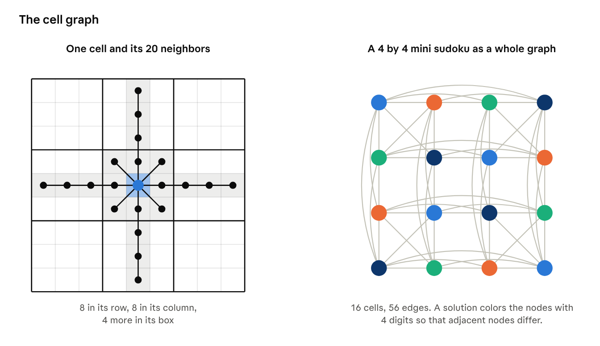

*Figure 3. the grid as a graph · one cell's neighbors, and a whole mini sudoku*

Left: the blue cell must differ from each of the 20 shaded cells. Right: the same graph for a 4 by 4 sudoku. Each edge joins two cells that must differ, and the four colors are the four digits.

Strategies work on candidates, so the graph used from here on has a node for each candidate.

**Candidates.** A *candidate* is a triple (r, c, d): digit d in the cell at row r, column c. There are 9 × 9 × 9 = 729 of them.

**Constraint sets.** Each rule of sudoku says that exactly one of nine candidates is true. There are four kinds, 81 of each, 324 in all:

```math
\begin{aligned}
\mathrm{Cell}(r,c) &= \{(r,c,d) : 1 \le d \le 9\} \\
\mathrm{Row}(r,d) &= \{(r,c,d) : 1 \le c \le 9\} \\
\mathrm{Col}(c,d) &= \{(r,c,d) : 1 \le r \le 9\} \\
\mathrm{Box}(b,d) &= \{(r,c,d) : \text{cell } (r,c) \text{ lies in box } b\}
\end{aligned}
```

Every candidate is in exactly four constraint sets, one of each kind. A *solution* is a set T of candidates with exactly one member in every constraint set. This is sudoku as an exact-cover problem \[5\].


*Figure 4. candidates and constraint sets · one example*

**States.** A *state* P is the set of candidates still on the grid. Sol(P) is the set of solutions that use only candidates from P; it is assumed to be non-empty. For a solution T, a candidate is *true* if it is in T and *false* otherwise. We write T(u) = 1 or 0.

A candidate *can be eliminated* if it is false in every solution in Sol(P). Removing it loses no solution.

**Edges.** Two candidates in P are joined by an *edge*, and are *adjacent*, if some constraint set contains both. That means two digits in one cell, or one digit in two cells of the same row, column or box. The edge is *strong* if some constraint set contains those two and no other candidate of P. Otherwise it is *weak*.

**What an edge does.** If a candidate is true, every candidate adjacent to it is false. If a candidate is false and one of its edges is strong, the other endpoint of that edge is true. Each strategy is a sequence of these two steps, so on the graph it is a path or a cycle.

The *candidate graph* W(P) has the candidates of P as nodes and all these edges. The *strong graph* S(P) has only the strong edges.

In the empty grid every candidate has 28 neighbors in the candidate graph: the 8 other digits of its cell, and the same digit in the 20 neighboring cells. As candidates are removed, edges disappear and some become strong.


*Figure 5. one candidate and all its edges in the empty grid*

Each dashed line is a weak edge. The candidate graph of the empty grid has 729 such nodes.

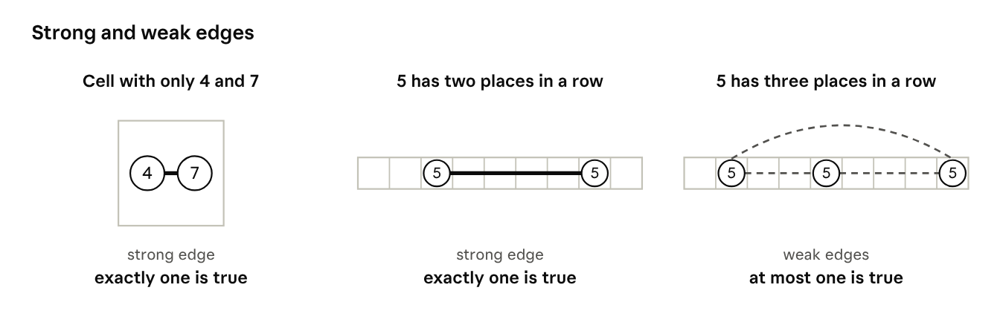

*Figure 6. strong and weak edges · three small examples*

Solvers call the two kinds of strong edge in Figure 6 *bivalue* and *bilocation*.

**Lemma 3.1 (edge rules).** Let T be a solution and uv an edge.

1.  At most one of u, v is true: T(u) + T(v) ≤ 1.

2.  If the edge is strong, exactly one is true: T(u) + T(v) = 1.

*Proof.* Some constraint set A contains both, and T has exactly one member in A. This gives rule 1. If the edge is strong, A can be chosen so that u and v are its only candidates in P. The member of T in A is in P, so it is u or v. ∎

## 4. A counting identity for cycles

Take a solution T and a cycle C of length k in the candidate graph. Let

- t be the number of true candidates on C;

- f be the number of edges of C whose endpoints are both false.

**Lemma 4.1.**

```math
f = k - 2t
```

*Proof.*

1.  No edge has two true endpoints (Lemma 3.1).

2.  Each true candidate is on exactly two edges of the cycle.

3.  So the true candidates are on 2t edges, and no edge is counted twice. Each of these edges has exactly one true endpoint.

4.  The other k − 2t edges have both endpoints false. ∎


*Figure 7. proof of Lemma 4.1 · three steps on a 7-cycle*

Consequences:

1.  **Parity.** f is odd when k is odd and even when k is even. So every odd cycle has at least one edge with both endpoints false.

2.  **Such an edge is weak.** A strong edge has a true endpoint (Lemma 3.1).

3.  **At most half are true.** Since f ≥ 0, t ≤ k/2.

4.  **Strong edges.** If C has m strong edges forming a matching, each has its own true endpoint. So t ≥ m, and f ≤ k − 2m.

Figure 8 shows three more cycles. Green candidates are true, thick edges have both endpoints false, and f = k − 2t in each.


*Figure 8. Lemma 4.1 on three cycles*

Consequence 3 on an odd cycle, t ≤ (k − 1)/2, is the odd-cycle inequality for stable sets \[4\].

## 5. What a cycle forces

From here on, P is a state with at least one solution, and true and false refer to any one solution. A *matching* is a set of edges no two of which have a common endpoint. It is a *perfect matching* of a set X of nodes if the endpoints of its edges are exactly X.

**Theorem 5.1 (strong edges are 2-colorable).** The strong graph S(P) has no odd cycle. In each component K of S(P), with color classes K0 and K1, every solution makes one class all true and the other all false.

*Proof.* Each strong edge has exactly one true endpoint (Lemma 3.1). So true and false form a 2-coloring of the strong graph, and by Theorem 2.1 it has no odd cycle. A connected graph has two 2-colorings (Corollary 2.2): K0 true and K1 false, or the reverse. ∎


*Figure 9. Theorem 5.1 · one component, two possibilities*

Fixing one candidate of a component fixes all of it.

If the strong edges of a grid contain an odd cycle, the grid has no solution.

**Theorem 5.2 (odd cycle, elimination).** Let C be a cycle in the candidate graph and v a candidate on it. If the strong edges of C contain a perfect matching of the other candidates of C, then C is odd and v is false in every solution.

*Proof.* Let C have length k. The matching has (k − 1)/2 edges, so k is odd. Each of them has a true endpoint other than v. If v were true, C would have (k + 1)/2 true candidates. Lemma 4.1 allows at most k/2. ∎


*Figure 10. Theorem 5.2 in four steps · a 5-cycle*

Figure 10 shows the same proof as a sequence of steps: if v is true, two adjacent candidates are both true.

In this case exactly one edge of the cycle has both endpoints false: the matching gives t ≥ (k − 1)/2, Lemma 4.1 gives t ≤ (k − 1)/2, so f = k − 2t = 1.

**Theorem 5.3 (odd cycle, placement).** Let v be a candidate on a cycle C, with neighbors a and b on C. If the edges va and vb are strong, and the strong edges of C contain a perfect matching of the candidates other than v, a and b, then C is odd and v is true in every solution. Every candidate adjacent to v is then false.

*Proof.* The matching has (k − 3)/2 edges, so k is odd. If v were false, a and b would both be true, and each edge of the matching would have another true endpoint. That gives (k + 1)/2 true candidates, more than Lemma 4.1 allows. ∎

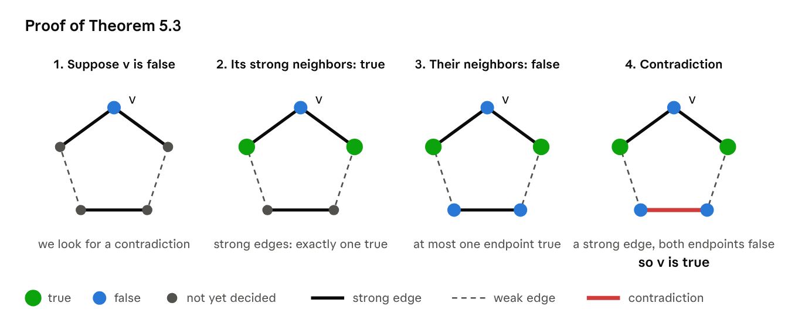

*Figure 11. Theorem 5.3 in four steps · a 5-cycle*

In Figure 11, if v is false, a strong edge has both endpoints false.

**Theorem 5.4 (even cycle).** Let C be a cycle whose strong edges contain a perfect matching of C. Then C is even, and every edge of C has exactly one true endpoint. So any candidate outside C adjacent to both endpoints of an edge of C is false.

*Proof.* The matching has k/2 edges, so k is even. Consequence 4 of Lemma 4.1 gives f ≤ k − 2(k/2) = 0, so every edge has a true endpoint. A candidate adjacent to both endpoints of such an edge is adjacent to a true candidate, so it is false. ∎

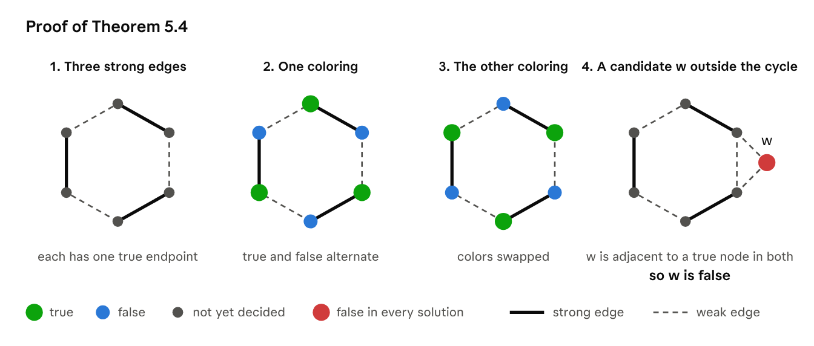

*Figure 12. Theorem 5.4 in four steps · a 6-cycle*

Three strong edges need three true candidates among six, and no two true candidates are adjacent. Only the two alternating patterns satisfy this.

Figure 13 shows Theorems 5.2 to 5.4 together. Solid lines are strong edges; dashed lines can be weak or strong.


*Figure 13. three cycle patterns · Theorems 5.2 to 5.4*

**Corollary 5.5 (coloring rules).** Let K be a component of the strong graph with classes K0 and K1. Let K′ be another component with classes K′0 and K′1.

1.  *Rule 1.* If an edge joins two candidates of K0, then K0 is false and K1 is true.

2.  *Rule 2.* If a candidate v outside K is adjacent to a candidate of K0 and to one of K1, then v is false.

3.  *Rule 3.* Suppose an edge joins a candidate of K0 to one of K′0. If v, outside both components, is adjacent to a candidate of K1 and to one of K′1, then v is false.

4.  *Rule 4.* If edges join a in K0 to c in K′0, and b in K0 to d in K′1, then K0 is false and K1 is true.

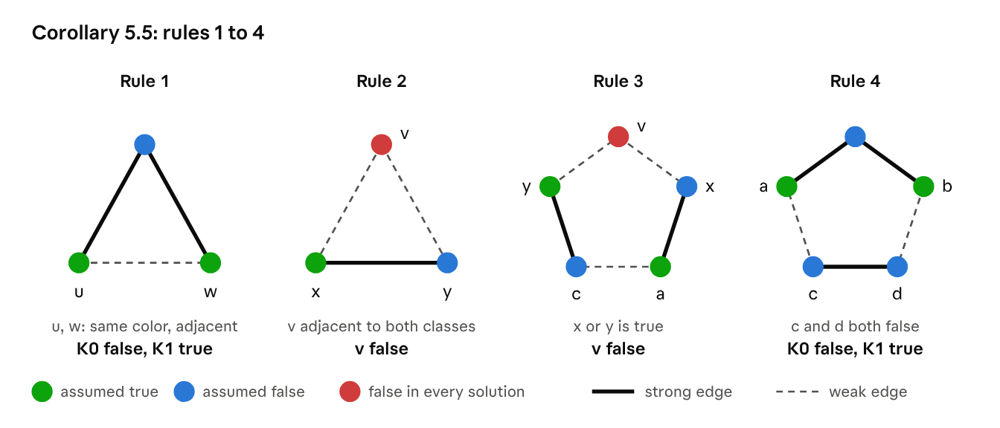

*Figure 14. Corollary 5.5 · rules 1 to 4*

*Proof.* Each rule forms an odd cycle and applies Theorem 5.2. Two facts are used. Within a component, a path of strong edges joins any two candidates; its length is even if they are in the same class and odd if not. A path with an even number of nodes has a perfect matching: its 1st, 3rd, 5th, ... edges.

- *Rule 1.* Let the edge join u and w in K0. A strong path from u to w has even length, at least 2, and with the edge it forms a cycle. Without u, an even number of nodes remain on a strong path, which has a perfect matching. Theorem 5.2 makes u false, and Theorem 5.1 then determines both classes.

- *Rule 2.* Let v be adjacent to x in K0 and y in K1. A strong path from x to y has odd length and does not contain v. With the two edges it forms a cycle through v, and the path has a perfect matching. Theorem 5.2 makes v false.

- *Rule 3.* Let the edge join a in K0 to c in K′0, and let v be adjacent to x in K1 and y in K′1. Strong paths from x to a and from c to y both have odd length. With the three edges they form a cycle through v. Its nodes are all different, because K, K′ and v are disjoint. Each path has a perfect matching of its own edges. Theorem 5.2 makes v false.

- *Rule 4.* If a = b, then a is adjacent to both classes of K′, so rule 2 makes a false. Otherwise a strong path from a to b has even length and one from d to c has odd length. With the two edges they form a cycle. Without a, each part has an even number of nodes and a perfect matching. Theorem 5.2 makes a false. In both cases Theorem 5.1 makes K0 false and K1 true. ∎

The next rule does not need strong edges.

**Corollary 5.6.** Take an odd cycle in the candidate graph. For each of its edges choose a constraint set containing both endpoints, and let R be the other candidates of P in the chosen sets. Then at least one candidate of R is true. So a candidate adjacent to every candidate of R is false, and if R has only one candidate, it is true.

*Proof.* An odd cycle has an edge uv with both endpoints false (Lemma 4.1, consequence 1). The constraint set chosen for uv has a true candidate, and it is neither u nor v. So it is in R. ∎

## 6. The strategies

Each strategy below is one of the results above applied to a particular arrangement of edges.

| Strategy | Shape in the candidate graph | Result used | Result |
| --- | --- | --- | --- |
| Naked pair | 4-cycle: two cells of a unit, each holding only a and b | Theorem 5.4 | a and b are removed from the rest of the unit |
| Hidden pair | 4-cycle: a and b each fit only the same two cells of a unit | Theorem 5.4 | Other digits are removed from those two cells |
| X-Wing | 4-cycle of one digit: two strong edges in parallel lines | Theorem 5.4 | Other candidates in the two crossing lines are removed |
| Swordfish, 2-2-2 form | 6-cycle of one digit: three strong edges in three lines | Theorem 5.4 | Other candidates in the three crossing lines are removed |
| X-Cycle, continuous | Even cycle of one digit, strong edges alternating | Theorem 5.4 | Candidates adjacent to both endpoints of an edge of the cycle are removed |
| X-Cycle, two weak edges at v | Odd cycle of one digit | Theorem 5.2 | v is false |
| X-Cycle, two strong edges at v | Odd cycle of one digit | Theorem 5.3 | v is true |
| Skyscraper | 5-cycle of one digit: two strong edges in parallel lines, joined by a third line | Theorem 5.2 | A candidate adjacent to the two unmatched candidates is removed |
| Two-String Kite | 5-cycle of one digit: a strong edge in a row and one in a column, joined in a box | Theorem 5.2 | A candidate adjacent to the two unmatched candidates is removed |
| Turbot Fish | Any 5-cycle of one digit with two strong edges | Theorem 5.2 | The fifth candidate is removed |
| XY-Wing | 7-cycle through three two-digit cells: pivot ab, wings ac and bc | Theorem 5.2 | c is removed from cells adjacent to both wings |
| W-Wing | 7-cycle: two cells holding ab, joined by a strong edge on a | Theorem 5.2 | b is removed from cells adjacent to both |
| XY-Chain | Longer odd cycle through two-digit cells | Theorem 5.2 | The end digit is removed from cells adjacent to both end cells |
| Remote Pairs | An even number of cells in a chain, all holding ab | Theorem 5.2, twice | a and b are removed from cells adjacent to both end cells |
| Simple Coloring | One component of strong edges of one digit | Corollary 5.5, rules 1 and 2 | A color class, or a candidate adjacent to both classes, is removed |
| 3D Medusa | One component of strong edges across digits | Corollary 5.5, rules 1 and 2 | The same |
| Multi-Coloring | Two components of one digit | Corollary 5.5, rules 3 and 4 | A candidate, or a color class, is removed |
| Broken Wing | Odd cycle of one digit with one weak edge | Corollary 5.6 | A candidate of R is true, or candidates adjacent to all of R are removed |
| Alternating Inference Chain | Any cycle across digits, strong edges alternating | Theorems 5.2 to 5.4 | As above |

The smallest case is a triangle: a candidate adjacent to both endpoints of a strong edge is false (Theorem 5.2 with k = 3). Solvers call this a pointing pair or box-line reduction when the digit has two places.

The examples below write candidates as (row, column, digit).

**X-Wing.** Digit 2 has two places in column 4 and two in column 8, in rows 4 and 7 both times. This gives strong edges (4,4,2)–(7,4,2) and (4,8,2)–(7,8,2). Edges along rows 4 and 7 complete a 4-cycle, and the two strong edges are a perfect matching of it. By Theorem 5.4 each row edge has exactly one true endpoint, so (4,6,2) and (7,5,2) are false.

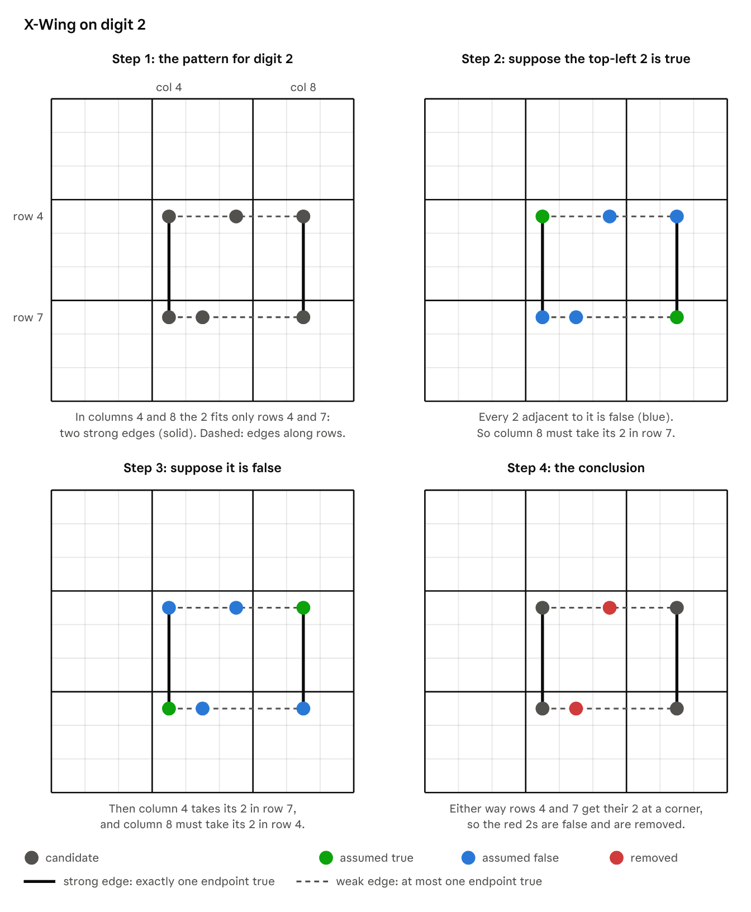

*Figure 15. X-Wing on digit 2 · four steps on the grid*

Steps 2 and 3 are the two colorings of the cycle. The red candidates are false in both.

**X-Cycle.** For digit 8 there are strong edges (3,2,8)–(7,2,8) in column 2, (8,3,8)–(8,9,8) in row 8 and (9,7,8)–(3,7,8) in column 7. Edges in box 7, box 9 and row 3 join them into a 6-cycle, and the strong edges are a perfect matching of it. Theorem 5.4 removes the other 8s in row 3, box 7 and box 9: (3,3,8), (3,9,8), (7,3,8) and (7,9,8).

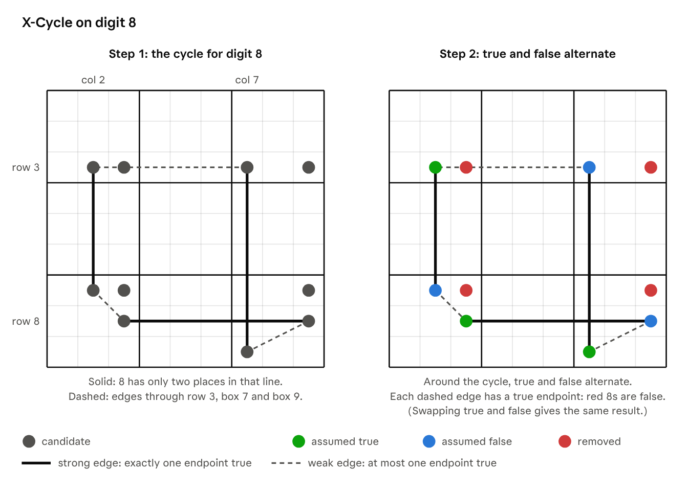

*Figure 16. X-Cycle on digit 8 · two steps on the grid*

**Simple Coloring.** For digit 6 the strong edges form one path: (2,2,6), (2,6,6), (1,5,6), (9,5,6), (9,3,6), (5,3,6). Color it alternately. The candidates (5,2,6) and (6,2,6) are each adjacent to (2,2,6), of one color, and to (5,3,6), of the other. Rule 2 makes both false.

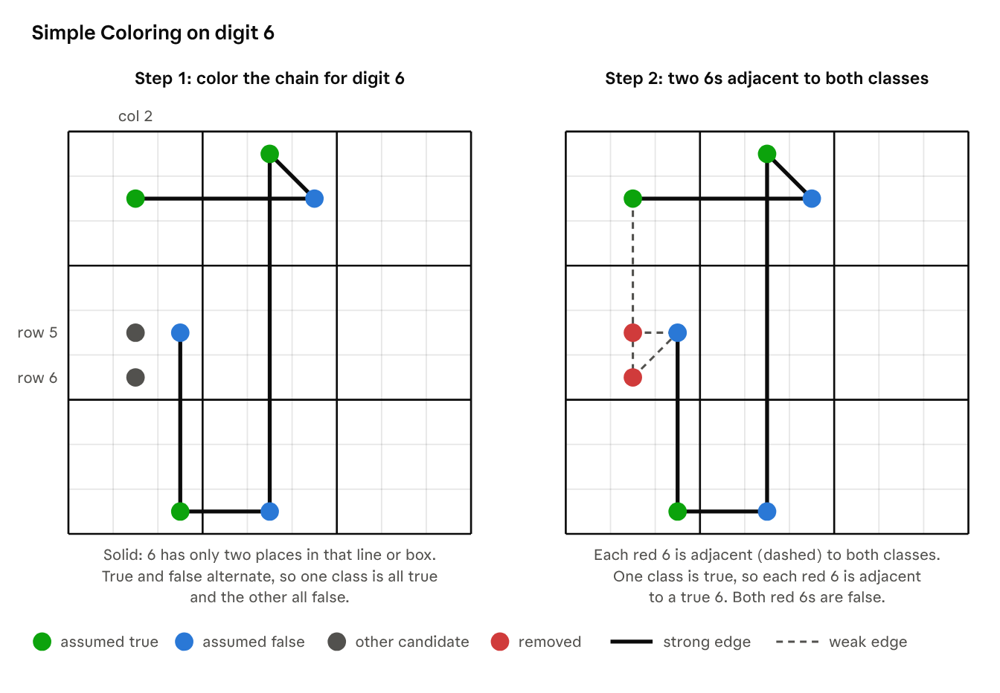

*Figure 17. Simple Coloring on digit 6 · two steps on the grid*

Each red candidate forms a 7-cycle with the path. This is the odd cycle in the proof of rule 2.

**3D Medusa.** The same coloring, except that the component may include several digits, joined through cells with two candidates. If two candidates of one color are adjacent, rule 1 removes that color. Colors can be compared only within one component.

**Multi-Coloring.** For digit 2 one component has classes K0 = {(4,6,2), (9,4,2), (1,5,2), (8,3,2)} and K1 = {(6,4,2), (8,5,2)}. A second component is the strong edge (4,1,2)–(7,1,2). Row 4 joins (4,6,2) to (4,1,2), and box 7 joins (8,3,2) to (7,1,2). So K0 is adjacent to both candidates of the second component. Rule 4 makes K0 false and K1 true, which places a 2 at row 6, column 4 and at row 8, column 5.

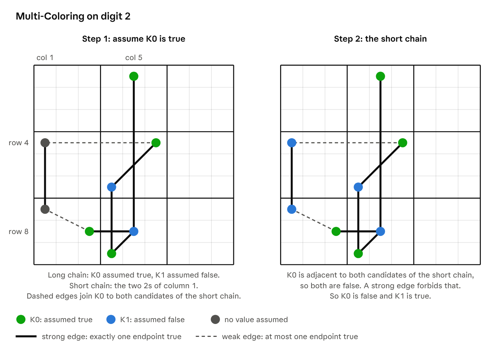

*Figure 18. Multi-Coloring on digit 2 · two steps on the grid*

If K0 were true, both endpoints of the strong edge (4,1,2)–(7,1,2) would be false.

**Naked pair.** Two cells of a row each hold only 4 and 7. In each cell the two candidates are joined by a strong edge. In the row the two 4s are adjacent, and so are the two 7s. This is a 4-cycle, and the two cell edges are a perfect matching of it. By Theorem 5.4 the row's 4 and 7 are both in those two cells, so the other 4s and 7s in the row are removed. A hidden pair is the same cycle with cells and digits swapped.

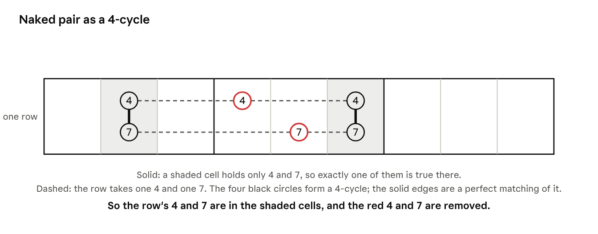

*Figure 19. naked pair · the 4-cycle drawn on one row*

**Skyscraper and Two-String Kite.** Both are 5-cycles of one digit with two strong edges, so both are Theorem 5.2. In a Skyscraper the strong edges are in two columns, and one candidate of each is in the same row. In a Kite one strong edge is in a row, the other in a column, and a box joins them. Any 5-cycle of this kind is called a Turbot Fish.

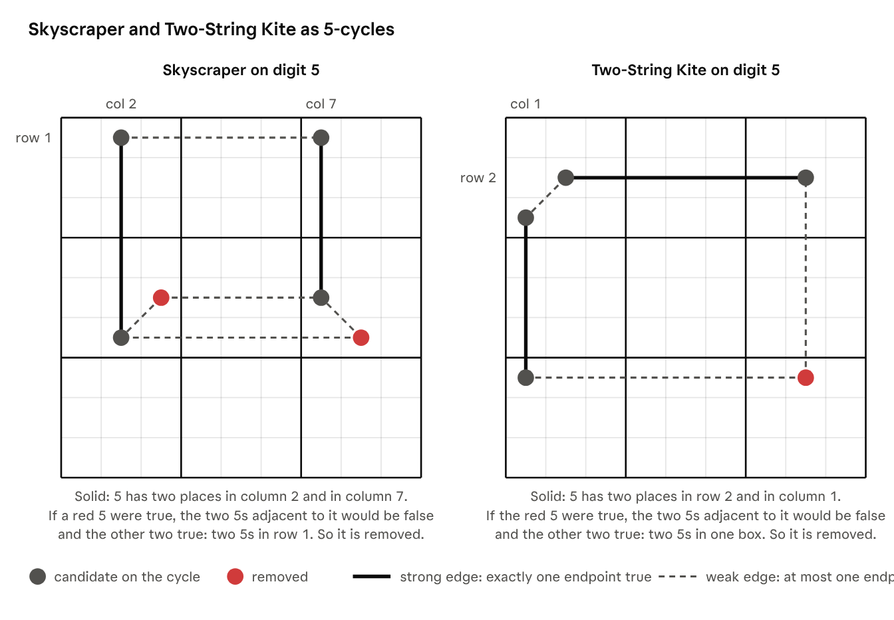

*Figure 20. Skyscraper and Two-String Kite · 5-cycles on the grid*

**XY-Wing.** Three cells hold the pairs 12, 13 and 23, and the pivot (12) is adjacent to both wings. The cycle is: 3 in the first wing, 1 in the first wing, 1 in the pivot, 2 in the pivot, 2 in the second wing, 3 in the second wing, and a 3 adjacent to both wings. The three cell edges are strong and form a perfect matching of six of the seven candidates. Theorem 5.2 removes the seventh. W-Wing, XY-Chain and Remote Pairs are longer cycles of the same kind.

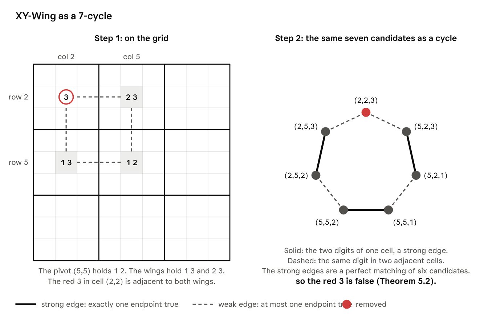

*Figure 21. XY-Wing · on the grid and as a 7-cycle*

**Broken Wing.** Take an odd cycle of one digit in which every edge but one is strong. By Corollary 5.6, the row, column or box of the weak edge has the digit in one of its other cells, the set R. If R has one candidate, it is true. Otherwise a candidate adjacent to all of R is removed.


*Figure 22. Corollary 5.6 · an odd cycle with one weak edge*

## 7. Limits and extensions

**A cycle of weak edges does not eliminate anything.** In the empty grid, every candidate is true in some solution. To show this, write r − 1 = 3q + m and c − 1 = 3s + n with q, m, s, n in {0, 1, 2}, and let G(r, c) be the digit with

```math
G(r,c) - 1 \equiv 3m + q + 3s + n \pmod 9 .
```

Along a row, 3s + n takes the values 0 to 8. Down a column, 3m + q does. In a box, 3m + n does. Adding a constant modulo 9 keeps nine values different, so G is a completed grid. Renaming its digits puts any digit in any cell.

The three 1s in the first three cells of row 1 form a triangle of weak edges, an odd cycle. Each of them is true in some solution, so none can be eliminated.


*Figure 23. three 1s in one row of the empty grid · four kinds of solution*

Lemma 4.1 still holds: the number of edges with both endpoints false is odd in each case. It does not determine which edge has both endpoints false; strong edges are needed for that. The same holds for even cycles: four 1s in one row form a 4-cycle of weak edges and determine nothing.

**Rules that use a whole constraint set.** The last two 3D Medusa rules in \[8\] are of this kind.

**Proposition 7.1.** Let K0 be a color class of a component of the strong graph, and A a constraint set. If every candidate of A in P is adjacent to some candidate of K0, then K0 is false and the other class is true.

*Proof.* If K0 were true, every candidate of A would be false (Lemma 3.1). A solution has a member in A, so K0 is not true, and by Theorem 5.1 the other class is. ∎

**What edges alone can prove.** Exactly what closed alternating walks prove. Read each weak edge uv as the clause ¬u ∨ ¬v, and each strong edge as the two clauses ¬u ∨ ¬v and u ∨ v. A true/false assignment on P that satisfies all these clauses is a *model* of the edges. Every solution is a model of the edges. An *alternating walk* from u is a sequence u = a(0), a(1), ..., a(n) in which steps at even positions are edges and steps at odd positions are strong edges. Nodes may repeat. The walk is *closed* if n is odd, n ≥ 3 and a(n) = u.

**Proposition 7.2 (closed walks).**

1.  If a closed alternating walk starts at u, then u is false in every model of the edges, and so in every solution.

2.  If none does, some model of the edges makes u true.

A closed alternating walk with no repeated node is the cycle of Theorem 5.2.

*Proof, part 1.* Suppose u is true. An edge from a true candidate leads to a false one, and a strong edge from a false candidate leads to a true one. So a(0), a(2), a(4), ... are true, including a(n − 1). But a(n − 1) is adjacent to u, and both are true, which contradicts Lemma 3.1.

*Proof, part 2.* Let E be the candidates reached from u by alternating walks of even length, u included. Let O be the candidates adjacent to some member of E.

1.  No two members of E are adjacent. If e and e′ were, then the walk from u to e, the edge to e′, and the walk to e′ reversed would form a closed alternating walk. The edge to e′ is an even step, and the reversed walk has its strong edges at odd steps. Its length is at least 3 because e and e′ differ. This contradicts the assumption. So E and O are disjoint.

2.  A strong edge from a member o of O leads into E: extend the walk that reaches the neighbor of o in E by o, then by the other endpoint of the strong edge.

3.  Take any solution T. Make E true, O false, and everything else as in T.

4.  Check each edge pq. If one endpoint is in E, the other is in O, and the sum is 1. If no endpoint is in E and one is in O, the sum is at most 1, and by point 2 the edge is not strong. If neither endpoint is in E or O, the values are those of T, which satisfy Lemma 3.1.

So the assignment is a model of the edges and makes u true. ∎

The clauses form a 2-SAT instance, and Proposition 7.2 is the 2-SAT argument \[6\] applied to it.

**Proposition 7.3 (a deduction edges do not reach).** In some state a candidate can be eliminated, although a model of the edges makes it true.

*Proof.* Take every candidate, except that the first three cells of row 1 keep only the digits 1, 2 and 3. The grid G fits, so a solution exists. In any solution those three cells hold 1, 2 and 3 in some order, so the 1 in cell 4 of row 1 is false.

No constraint set has exactly two candidates left. The counts are 3 for the three restricted cells, 6 for digits 4 to 9 in row 1 and in box 1, 8 for digits 4 to 9 in columns 1 to 3, and 9 for the rest. So there is no strong edge, and making that candidate true and all others false is a model of the edges. ∎

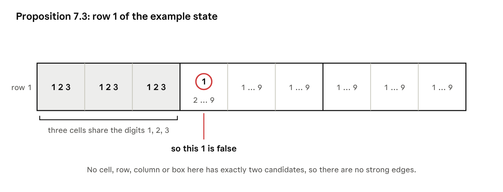

*Figure 24. Proposition 7.3 · row 1 of the example state*

This is a *naked triple*. It counts three cells against three digits and uses no strong edge.

So edges alone cover pairs, wings, kites, chains, cycles and coloring. They do not cover naked and hidden triples, fish with three or more candidates in a line, XYZ-Wing, or chains in which a group of cells acts as one node, such as the Empty Rectangle. These need rules about three or more candidates at once. The rest of this section gives them.

### Extensions

Two extensions keep the true/false coloring: larger nodes, and counting over whole constraint sets.

**1. Groups as nodes.** Take one digit, and two or three of its candidates in cells of one box that share a row or column. Call that a *group*. A group is true when one of its members is true, and false when all of them are false. A single candidate is a group of one.

Two groups are *adjacent* when they have no common candidate and some constraint set contains both. The edge is *strong* when together they are all the candidates left in that set.

**Lemma 7.4 (groups satisfy the edge rules).** Let A and B be adjacent groups and T a solution. At most one of A, B is true. If the edge is strong, exactly one is.

*Proof.* Both are in one constraint set, which has exactly one true candidate. That candidate is not in both A and B, because they have no common candidate. If A and B together are the whole set, it is in one of them. ∎

Lemma 4.1 and Theorem 5.2 use only these two rules, so they hold when some nodes are groups. This covers:

- **Locked triple.** A digit has three places in one unit, all inside a second unit. The three form a group that is true in every solution, so every other candidate of that digit in the second unit is adjacent to a true node and is false.

- **Empty Rectangle** and **grouped X-Cycles.** These are odd cycles of one digit in which some nodes are groups.

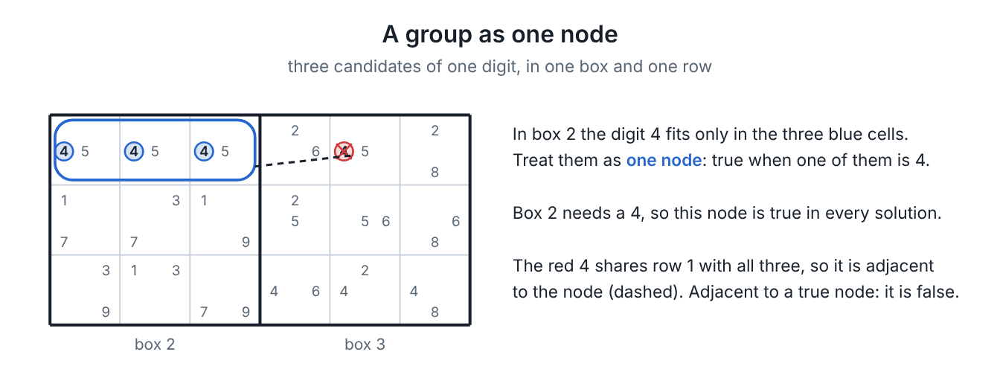

*Figure 25. A group as one node · a locked triple*

**2. Counting over constraint sets.**

**Theorem 7.5 .** Let B1, ..., Bk be constraint sets with no common candidates, and C1, ..., Ck be k constraint sets. Suppose every candidate in the B's is also in some C. Then every candidate in the C's that is in no B is false in every solution.

*Proof.* Each B has exactly one true candidate, and the B's are disjoint, so they have k true candidates. Each of these is in some C. A C has only one true candidate, so the k true candidates are in k different C's. That is all k of the C's, so each C has its true candidate in the B's. A candidate of a C outside the B's is therefore false. ∎

As with Lemma 4.1, the proof counts true candidates in two ways.

As nodes: for each C, the candidates it shares with the B's form one group node, and the count shows that node is true. Every other candidate of that C is adjacent to it, so it is false. This is the locked triple argument with a count in place of a single constraint set.


*Figure 26. Theorem 7.5 on a naked triple · k = 3*

This also has a graph form. Make each constraint set a node, and each candidate an edge joining two of its sets, for example its cell and its row-and-digit set. This graph is bipartite: cells on one side, row-and-digit sets on the other. A solution chooses edges so that every node is used once, a perfect matching. Theorem 7.5 is the counting step of Hall's theorem for this graph: k nodes on one side whose edges reach only k nodes on the other side must be matched to exactly those.


*Figure 27. The second graph · sets as nodes, candidates as edges*

Cases of Theorem 7.5:

| Strategy | The B's | The C's |
| --- | --- | --- |
| Naked pair, triple, quad | k cells of one unit | the k digits they hold, in that unit |
| Hidden pair, triple, quad | k digits in one unit | the k cells they fit in |
| X-Wing, Swordfish, Jellyfish | one digit in k rows | the same digit in k columns |

With k = 2 these are the naked pair, hidden pair and X-Wing of Theorem 5.4: the 4-cycle with two strong edges is the case k = 2. The naked triple of Proposition 7.3 is the case k = 3.

**3. Clauses u ∨ v from counting.** The proof of Theorem 5.2 uses each strong edge in one direction only: if one endpoint is false, the other is true. So it also holds when some strong edges are replaced by pairs of nodes that are not both false, that is, by clauses u ∨ v without ¬u ∨ ¬v.

**Lemma 7.6 (XYZ-Wing).** Let a cell p hold x, y and z. Let p be adjacent to a cell holding x and z, and to a cell holding y and z. Then at least one of the three z's in those cells is true.

*Proof.* The cell p is x, y or z. If it is x, the cell holding x and z is z. If it is y, the cell holding y and z is z. Otherwise p is z. ∎

So the z in p and the z in the first wing form one node, and the z in the second wing another. They cannot both be false. A candidate z adjacent to all three cells is adjacent to both nodes. If it were true, both nodes would be false, which the lemma excludes. This is the **XYZ-Wing**, a triangle like the Locked pair.

**Lemma 7.7 (almost-locked set).** An *almost-locked set* is n cells of one unit that hold n + 1 digits between them. For each of its digits, the candidates of that digit in the set form a node. The nodes of two different digits cannot both be false.

*Proof.* If both were false, the n cells would have n − 1 digits between them. Cells of one unit need different digits, so this is impossible. ∎

So in an almost-locked set, nodes of two different digits satisfy the clause u ∨ v. Nodes of the same digit in two different sets are adjacent in the usual way when all their cells are adjacent. This is all Theorem 5.2 needs, so cycles can pass through almost-locked sets:

- **Two sets (ALS-XZ, WXYZ-Wing, XYZ-Wing).** Sets A and B share a digit x whose candidates are all adjacent across the sets, and another digit z. The cycle is: a candidate z adjacent to every z of both sets, the z node of A, the x node of A, the x node of B, the z node of B. If the candidate were true, both z nodes would be false, so both x nodes would be true, and they are adjacent.

- **Three or more sets (ALS-XY-Wing, chains of almost-locked sets).** The cycle passes through more sets, changing digit at each.

- **Two sets with two connecting digits (including the basic Sue de Coq).** Each connecting digit is used by at most one set, so neither set has a spare digit, and every node of both sets is true.

**Finned fish.** Suppose a digit in k rows fits k columns except for a few extra places, the *fin*, all in one box. If every fin candidate is false, Theorem 7.5 applies and each column's node is true. So the fin node and a column's node cannot both be false. A candidate in that column and in the fin's box is adjacent to both, which forms a triangle.

**4. Remarks.**

*Triples as a coloring.* A solved grid colors the 81 cells with nine colors so that adjacent cells differ \[2\]. A naked triple is three mutually adjacent cells with the same list of three colors, so they use all three. Theorem 7.5 states the same by counting.

*Unique rectangle.* Four cells in two rows, two columns and two boxes, each holding only a and b, form an even cycle, which has exactly two colorings (Corollary 2.2). Nothing outside the four cells distinguishes them, so both would be solutions. A proper puzzle has one solution, so this pattern cannot occur, and a candidate that would complete it is false. The cycle and its two colorings are graph theory. The last step is not: it uses a property of the puzzle that is not one of the 324 constraint sets.

All four lemmas were checked by brute force on about 1,100 random states that contain a known solution: 1.1 million adjacent pairs of group nodes for Lemma 7.4, about 17,000 instances of Theorem 7.5 with k = 2, 3 and 4, about 1,700 XYZ configurations for Lemma 7.6, and about 385,000 almost-locked set instances for Lemma 7.7. There were no failures. The script is `proofs/verify_sets.py`.

**Not covered.** Trial and error reaches a contradiction through branching consequences rather than a cycle, a coloring or a count. The same applies to rare patterns such as the Exocet, which are not examined here.

## 8. Related work

The strategies and the cycle view of them are known. I have not found a single counting rule that proves all of them.

- **Sudoku as graph coloring.** Herzberg and Murty \[2\] color the 81 cells with nine digits. That graph describes a solution; it is not the candidate graph used here.

- **Bivalue and bilocation graphs.** Eppstein \[3\] builds graphs from the same strong edges and derives solving rules from their cycles. His rules use edge labels rather than 2-coloring or parity. This is the closest prior work.

- **Coloring.** HoDoKu \[7\] describes Simple Colors and Multi Colors, which are rules 1 to 4 of Corollary 5.5. SudokuWiki \[8\] describes 3D Medusa.

- **Cycles.** SudokuWiki \[8\] notes that a nice loop with one discontinuity has an odd number of nodes, and states the rules proved here as Theorems 5.2 and 5.3. Sudopedia \[9\] has the rule that is Theorem 5.4. Barker \[10\] observes that an odd cycle of strong edges cannot occur, and describes the Broken Wing (Corollary 5.6).

- **Background.** Theorem 2.1 is König's \[1\]. The odd-cycle bound is Padberg's \[4\]. The 2-SAT method is due to Aspvall, Plass and Tarjan \[6\]. Berthier \[11\] treats chains in formal logic.

## References

1.  D. König, *Theorie der endlichen und unendlichen Graphen*, Akademische Verlagsgesellschaft, Leipzig, 1936.

2.  A. M. Herzberg and M. R. Murty, Sudoku squares and chromatic polynomials, *Notices of the American Mathematical Society* 54 (2007), no. 6, 708–717. Summary: [Plus Magazine](https://plus.maths.org/content/solving-sudokus-coloring-numbers).

3.  D. Eppstein, [Nonrepetitive paths and cycles in graphs with application to Sudoku](https://arxiv.org/abs/cs/0507053), arXiv:cs/0507053, 2005.

4.  M. W. Padberg, On the facial structure of set packing polyhedra, *Mathematical Programming* 5 (1973), 199–215.

5.  D. E. Knuth, Dancing links, in *Millennial Perspectives in Computer Science*, Palgrave, 2000, 187–214. arXiv:cs/0011047.

6.  B. Aspvall, M. F. Plass and R. E. Tarjan, A linear-time algorithm for testing the truth of certain quantified Boolean formulas, *Information Processing Letters* 8 (1979), 121–123.

7.  B. Hobiger, [HoDoKu: Coloring techniques](https://hodoku.sourceforge.net/en/tech_col.php).

8.  A. Stuart, SudokuWiki: [X-Cycles, Part 2](https://www.sudokuwiki.org/X_Cycles_Part_2) and [3D Medusa](https://www.sudokuwiki.org/3D_Medusa).

9.  Sudopedia, [Nice Loop](https://sudopedia.sudocue.net/index.php/Nice_Loop).

10. A. Barker, [Odd Loops, Broken Wings, and Dark Logic](https://sudokuone.com/sweb/gen2/blacklog.htm).

11. D. Berthier, *The Hidden Logic of Sudoku*, Lulu, 2007.
