# Why Advanced Sudoku Strategies Work: One Graph-Theory Rule Behind X-Wing, X-Cycle and Coloring

2026-11-14 · Hyejun Shin

**What this is.** Advanced sudoku strategies have names like X-Wing, XY-Wing, Skyscraper and Simple Coloring. They are usually memorized as separate tricks. This write-up shows they are one idea, and proves it step by step.

**The idea.** Treat each candidate (a digit that could still go in a cell) as a node. Join two nodes when the rules forbid both from being true. One counting rule about loops of nodes then explains every strategy on the list.

**How to read it.** Steps 1 to 4 build the idea with pictures. Step 5 walks through more than a dozen named strategies. Step 6 shows where the idea stops working. No maths background is assumed, and each claim comes with a short "why".

**Try it.** The companion page [Solving Sudoku Using Graph Coloring](../index.html) (open `index.html` from the repository root in a browser) finds these loops in real puzzles and walks through each one, step by step.

## 1. The idea in one minute

1.  A *candidate* is one digit in one cell: a digit that could still go there.

2.  Two candidates are *adjacent* if the rules say they cannot both be true. Two 5s in one row are adjacent. So are two digits in one cell.

3.  An edge is *strong* if exactly one of the two must be true. That happens when a cell has only two candidates left, or a digit has only two places left in a row, column or box.

4.  Draw the candidates as nodes and the edges as lines. A solution marks each node true or false.

5.  **The counting rule.** Go round any loop of k nodes. The edges with both ends false number k minus twice the true nodes. So an odd loop always has such an edge, and it is never a strong one.

Everything else follows from point 5.

- Strong edges alone can always be 2-colored, true against false (Theorem 5.1).

- An odd loop with enough strong edges forces one candidate to be false (Theorem 5.2) or true (Theorem 5.3).

- An even loop with enough strong edges turns each of its edges into an either-or (Theorem 5.4).

None of the strategies is new, and Section 8 says who found them. What is here is one short proof for all of them. This write-up grew out of an earlier essay of mine.

## 2. Step 1: Graphs and two colors

A *graph* is a set of nodes with lines (*edges*) joining some pairs. Two nodes joined by an edge are *adjacent*, or *neighbors*. All our graphs are finite, and no edge joins a node to itself.

- A *path* of length n is a row of n + 1 different nodes, each adjacent to the next.

- A *cycle* of length k ≥ 3 is k different nodes v1, ..., vk in a ring: each is adjacent to the next, and vk to v1. It is *odd* or *even* as k is.

- A graph is *connected* if a path joins any two nodes. Its connected pieces are its *components*. The *distance* d(u, v) is the length of a shortest path from u to v.

- A *2-coloring* gives each node color 0 or 1 so that the two ends of every edge differ.

- A graph is *bipartite* if its nodes split into two groups X and Y with every edge running between the groups. That is the same as having a 2-coloring: X is color 0 and Y is color 1.

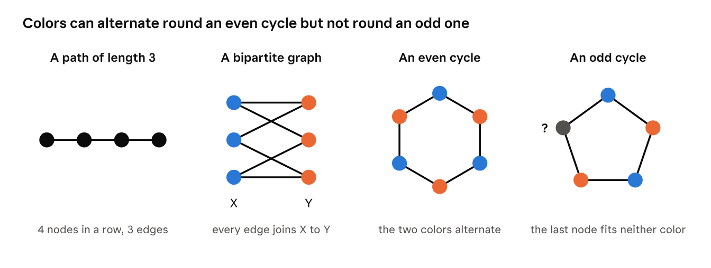

*Figure 1. paths, bipartite graphs, even and odd cycles*

Round a cycle the colors must alternate. That works only when the number of nodes is even. In the odd cycle above, the gray node has a neighbor of each color, so no color is left for it.

**Theorem 2.1 (König).** A graph is bipartite exactly when it has no odd cycle.

*Why, first half.* Suppose a 2-coloring exists and v1, ..., vk is a cycle. Neighbors differ, so vi has the color of v1 exactly when i is odd. But vk is adjacent to v1, so their colors differ, and k is even.

*Why, second half.* Suppose there is no odd cycle. No edge joins two components, so we can color one component at a time. Assume the graph is connected and fix a node r. We need two facts about distances from r.

- (D1) Adjacent nodes have distances from r that differ by at most 1.

- (D2) On a shortest path from r, the node in position i is at distance exactly i.

Both rest on one remark. A *walk* is like a path but may repeat nodes. A walk of length n from x to y shows d(x, y) ≤ n: keep cutting out the stretch between two visits to the same node until none repeats.

For (D1), a shortest path to u followed by v is a walk of length d(r, u) + 1, so d(r, v) ≤ d(r, u) + 1. Swap u and v for the other direction. For (D2), the first i steps form a path, so the distance is at most i. A shorter route to that node, followed by the rest of the path, would be a walk to the end that beats a shortest path.

Now the proof itself.

1.  Color each node by its distance from r: even distance color 0, odd distance color 1.

2.  Suppose some edge uv has both ends the same color. By (D1) their distances differ by at most 1. They have the same parity, so they are equal. Call the distance n.

3.  Take shortest paths A from r to u and B from r to v. Let w be the last node of A that is also on B, at distance j. By (D2), w is in position j on both paths.

4.  If w were u, then u would sit on B at distance n, which is where B ends. So u = v, impossible for the two ends of an edge. Likewise w is not v. So j \< n.

5.  Below w the two paths each have n − j ≥ 1 edges and share no node. With the edge uv they form a cycle of 2(n − j) + 1 edges. That is odd, against our assumption.

So no edge fails, and the coloring works. ∎

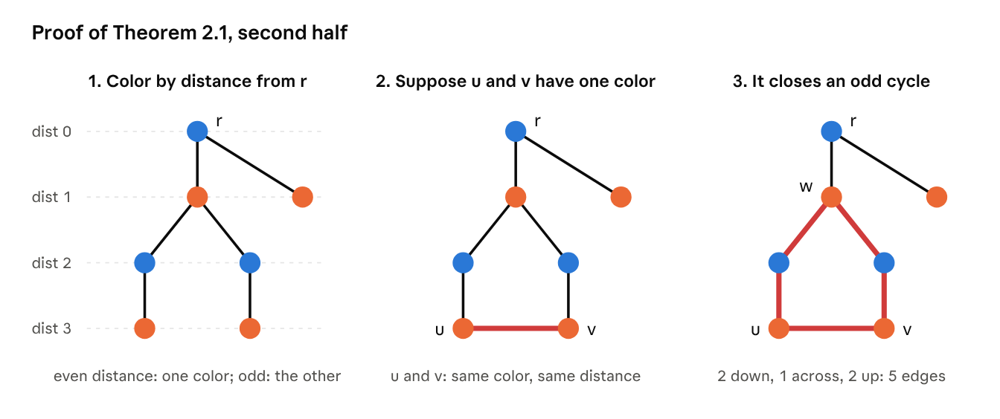

*Figure 2. Theorem 2.1, second half · three steps*

Here w is where the two shortest paths part for the last time. The two branches below w have equal length, so with the edge uv they always close an odd cycle.

**Corollary 2.2.** A connected bipartite graph has exactly two 2-colorings, and each is the other with the colors swapped.

*Why.* Fix a node r. Along a shortest path from r the colors alternate, so the color of r decides the color of every node. There are two choices for r, and both work: one 2-coloring exists by Theorem 2.1, and swapping its colors gives the other. ∎

The two color groups of a connected bipartite graph are its *color classes*. A path between two nodes of the same class has even length; between different classes, odd length.

A side note: a graph with no edges needs only one color. So bipartite means "at most two colors", not "exactly two".

## 3. Step 2: Sudoku as nodes and edges

**The grid is already a graph.** Every cell has 20 *neighbors*: the other cells of its row, its column and its box. Join each cell to its neighbors and the grid becomes one graph with 81 nodes and 810 edges. Solving a sudoku means coloring that graph with nine digits so that neighbors differ \[2\].


*Figure 3. the grid as a graph · one cell's neighbors, and a whole mini sudoku*

On the left, the blue cell must differ from each of the 20 shaded cells. On the right, the same idea drawn for every cell of a small 4 by 4 sudoku at once: each line means "these two must differ", and the four colors are the four digits.

That graph is too coarse for solving strategies, which are about candidates. So we go one level down and make every candidate a node.

**Candidates.** A *candidate* is a triple (r, c, d): digit d in the cell at row r, column c. There are 9 × 9 × 9 = 729 of them.

**Constraint sets.** Each rule of sudoku says "exactly one of these nine candidates is true". There are four kinds, 81 of each, 324 in all:

```math
\begin{aligned}
\mathrm{Cell}(r,c) &= \{(r,c,d) : 1 \le d \le 9\} \\
\mathrm{Row}(r,d) &= \{(r,c,d) : 1 \le c \le 9\} \\
\mathrm{Col}(c,d) &= \{(r,c,d) : 1 \le r \le 9\} \\
\mathrm{Box}(b,d) &= \{(r,c,d) : \text{cell } (r,c) \text{ lies in box } b\}
\end{aligned}
```

Every candidate lies in exactly four constraint sets, one of each kind. A *solution* is a set T of candidates with exactly one member in every constraint set. This is sudoku as an exact-cover problem \[5\].

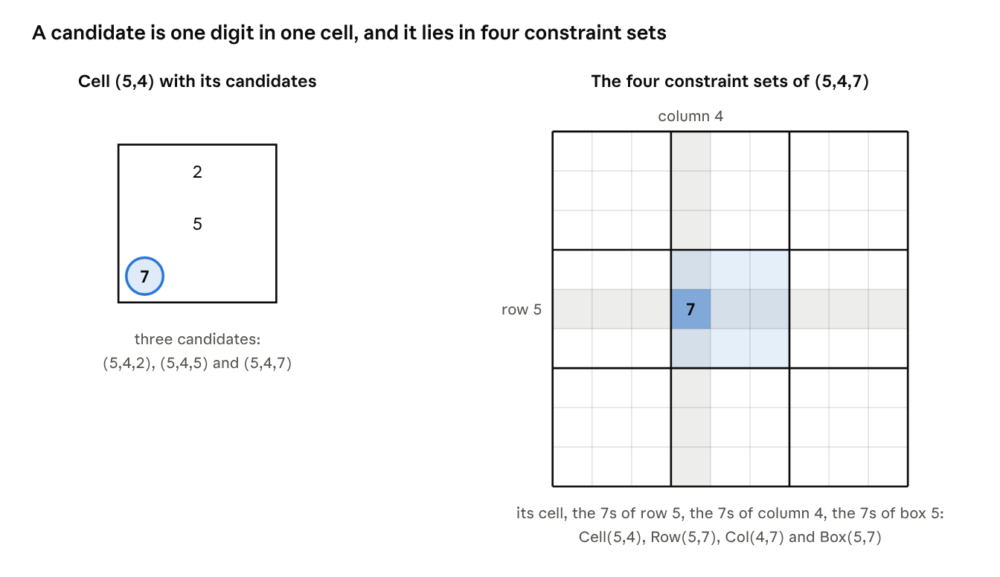

*Figure 4. candidates and constraint sets · one example*

**States.** A *state* P is the set of candidates still on the grid. Sol(P) is the set of solutions that use only candidates from P, and we always assume there is at least one. For a solution T, a candidate is *true* if it belongs to T and *false* otherwise. We write T(u) = 1 or 0.

A candidate *can be eliminated* if it is false in every solution in Sol(P). Erasing it loses no solution.

**Edges.** Two candidates in P are joined by an *edge*, and called *adjacent*, if some constraint set contains both. In practice that means two digits in one cell, or one digit in two cells of the same row, column or box. The edge is *strong* if some constraint set contains those two and no other candidate of P. Otherwise it is *weak*.

**Why draw the edges.** An edge is how a fact about one candidate becomes a fact about another. If a candidate is true, every candidate adjacent to it is false. If a candidate is false and one of its edges is strong, the candidate at the other end is true. Every strategy in this write-up is a chain of such steps, so on the graph each one shows up as a path or a loop.

Two graphs come out of this. The *candidate graph* W(P) has the candidates of P as nodes and all these edges. The *strong graph* S(P) keeps only the strong edges.

In the empty grid every candidate has 28 neighbors in the candidate graph: the 8 other digits of its cell, and the same digit in the 20 neighboring cells. As candidates are removed the graph thins out, and strong edges appear.

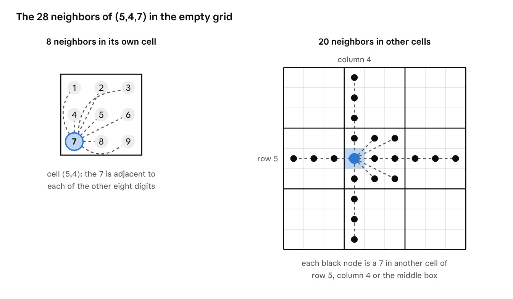

*Figure 5. one candidate and all its edges in the empty grid*

Every dashed line is a weak edge: the 7 in this cell and the thing at the other end cannot both be true. The whole candidate graph of an empty grid has 729 nodes like this one.


*Figure 6. strong and weak edges · three small examples*

Solvers call the first two pictures *bivalue* and *bilocation* edges.

**Lemma 3.1 (the two edge rules).** Let T be a solution and uv an edge.

1.  At most one of u, v is true: T(u) + T(v) ≤ 1.

2.  If the edge is strong, exactly one is true: T(u) + T(v) = 1.

*Why.* Some constraint set A contains both, and T has exactly one member in A. That gives rule 1. If the edge is strong, A can be chosen so that u and v are its only candidates left in P. The one member of T in A lies in P, so it is u or v. ∎

In short: a weak edge says "not both", a strong edge says "exactly one". Keeping the two apart is what makes everything below work.

## 4. Step 3: The counting rule

Pick a solution T and a cycle C of length k in the candidate graph. Count two things on C:

- t, the number of true candidates on C;

- f, the number of *empty* edges of C, meaning edges with both ends false.

**Lemma 4.1 (Cycle Lemma).**

```math
f = k - 2t
```

*Why.*

1.  No edge has two true ends (Lemma 3.1).

2.  Each true candidate sits on exactly two edges of the cycle.

3.  So the true candidates cover 2t edges, and no edge is counted twice. Each of these has exactly one true end.

4.  The remaining k − 2t edges have no true end. They are the empty ones. ∎

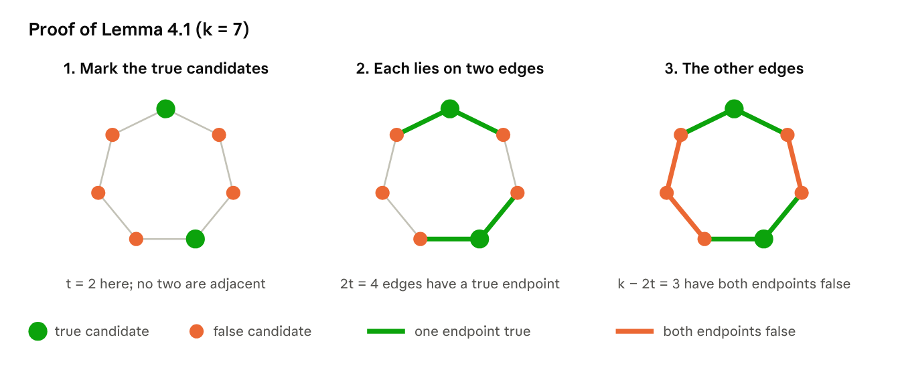

*Figure 7. proof of the Cycle Lemma · three steps on a 7-cycle*

Four things follow at once.

1.  **Parity.** f is odd when k is odd and even when k is even. So every odd cycle has at least one empty edge.

2.  **Empty edges are weak.** A strong edge always has a true end (Lemma 3.1).

3.  **At most half are true.** Since f ≥ 0, we get t ≤ k/2.

4.  **Strong edges count.** If C has m strong edges that share no node, each has its own true end. So t ≥ m, and f ≤ k − 2m.

Three more examples follow. Green candidates are true, thick edges are empty, and f = k − 2t every time.

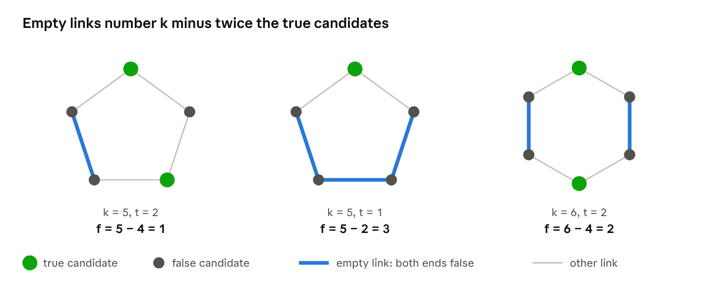

*Figure 8. the Cycle Lemma on three cycles*

For readers who know optimization: rule 3 on an odd cycle, t ≤ (k − 1)/2, is the classical odd-cycle inequality for stable sets \[4\].

## 5. Step 4: What a loop forces

From here on, P is a state with at least one solution, and "true" and "false" refer to any one solution. One piece of vocabulary: some edges *pair up* a set of candidates if no two of them share an end and their ends are exactly that set.

**Theorem 5.1 (strong edges 2-color).** The strong graph S(P) has no odd cycle. In each component K of S(P), with color classes K0 and K1, every solution makes one class all true and the other all false.

*Why.* Across a strong edge exactly one end is true (Lemma 3.1). So "true or false" is a 2-coloring of the strong graph, and Theorem 2.1 rules out odd cycles. A connected graph has only two 2-colorings (Corollary 2.2): K0 true and K1 false, or the reverse. ∎

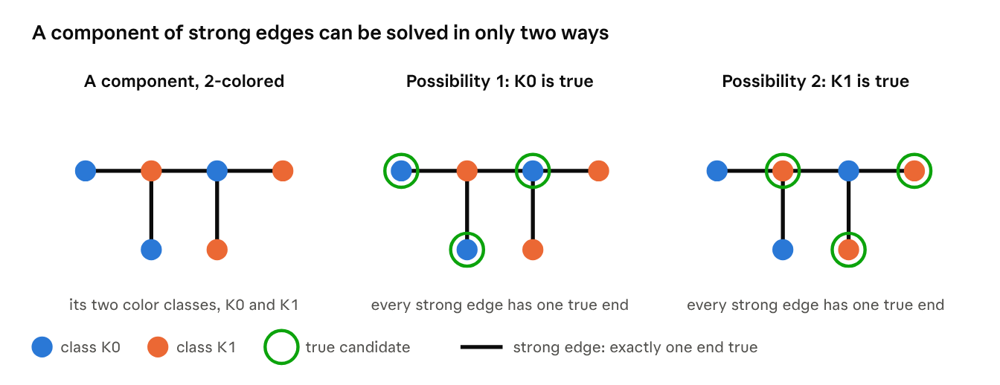

*Figure 9. Theorem 5.1 · one component, two possibilities*

Decide one candidate, and the strong edges decide the rest of its component one edge at a time.

A useful by-product: if the strong edges of your grid ever contain an odd cycle, the grid has no solution. A mistake has crept in.

**Theorem 5.2 (an odd loop forces a false).** Let C be a cycle in the candidate graph and v a candidate on it. If strong edges of C pair up all the other candidates of C, then C is odd and v is false in every solution.

*Why.* Say C has length k. The pairing uses (k − 1)/2 strong edges, so k is odd. Each of them has a true end, and none of those ends is v. If v were true as well, C would carry (k + 1)/2 true candidates. The Cycle Lemma allows at most k/2. ∎

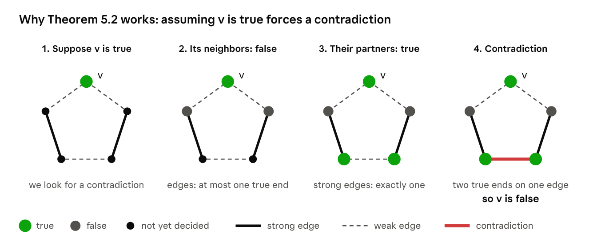

*Figure 10. Theorem 5.2 in four steps · a 5-cycle*

The same proof as a chain of forced moves: assuming v is true ends with two adjacent candidates both true.

In this situation exactly one edge of the loop is empty. The pairing forces t ≥ (k − 1)/2, the Cycle Lemma forces t ≤ (k − 1)/2, so f = k − 2t = 1.

**Theorem 5.3 (an odd loop forces a true).** Let v be a candidate on a cycle C, with neighbors a and b on C. If the edges va and vb are strong, and strong edges of C pair up all candidates other than v, a and b, then C is odd and v is true in every solution. Every candidate adjacent to v is then false.

*Why.* The pairing uses (k − 3)/2 strong edges, so k is odd. If v were false, a and b would both be true, and each pairing edge would add another true end. That makes (k + 1)/2 true candidates, more than the Cycle Lemma allows. ∎


*Figure 11. Theorem 5.3 in four steps · a 5-cycle*

This is the mirror image of the last picture: assuming v is false leaves a strong edge with no true end.

**Theorem 5.4 (an even loop makes every edge either-or).** Let C be a cycle whose strong edges pair up all of its candidates. Then C is even, and every edge of C has exactly one true end. So any other candidate adjacent to both ends of an edge of C is false.

*Why.* The pairing uses k/2 strong edges, so k is even. Rule 4 of the Cycle Lemma gives f ≤ k − 2(k/2) = 0, so no edge is empty. A candidate adjacent to both ends of such an edge is adjacent to a true candidate, so it is false. ∎


*Figure 12. Theorem 5.4 in four steps · a 6-cycle*

Three strong edges need three true ends among six candidates, and true candidates are never neighbors. Only the two alternating patterns manage that.

Here are the three loop theorems side by side.

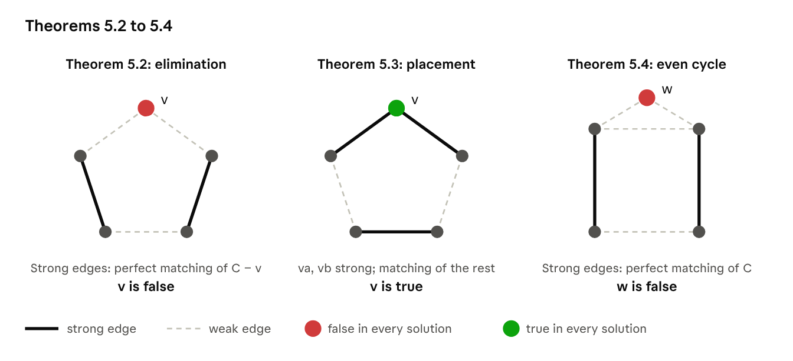

*Figure 13. three cycle patterns · Theorems 5.2 to 5.4*

Solid lines are strong edges. Dashed lines can be weak or strong.

**Corollary 5.5 (the coloring rules).** Let K be a component of the strong graph with classes K0 and K1. Let K′ be another component with classes K′0 and K′1.

1.  *Wrap.* If an edge joins two candidates of K0, then K0 is false and K1 is true.

2.  *Trap.* If a candidate v outside K is adjacent to a candidate of K0 and to one of K1, then v is false.

3.  *Bridge.* Suppose an edge joins a candidate of K0 to one of K′0. If v, outside both components, is adjacent to a candidate of K1 and to one of K′1, then v is false.

4.  *Double bridge.* If edges join a in K0 to c in K′0, and b in K0 to d in K′1, then K0 is false and K1 is true.


*Figure 14. Corollary 5.5 · Wrap, Trap, Bridge, Double bridge*

*Why.* Each rule closes an odd cycle and applies Theorem 5.2. Two facts do the work. Inside a component a path of strong edges joins any two candidates; its length is even if they share a class and odd if not. And a path with an even number of nodes is paired up by its 1st, 3rd, 5th, ... edges.

- *Wrap.* Say the edge joins u and w in K0. A strong path from u to w has even length, at least 2. With the edge it closes a cycle. Take away u, and an even number of nodes remain on a strong path, so they are paired up. Theorem 5.2 makes u false, and Theorem 5.1 then settles both classes.

- *Trap.* Say v is adjacent to x in K0 and y in K1. A strong path from x to y has odd length and misses v. The two edges close it into a cycle through v, and the path itself is paired up. Theorem 5.2 makes v false.

- *Bridge.* Say the bridge joins a in K0 to c in K′0, and v is adjacent to x in K1 and y in K′1. Take strong paths from x to a and from c to y; both have odd length. With the three edges they form a cycle through v. Its nodes are all different, because K, K′ and v are separate. Each path is paired up by its own edges. Theorem 5.2 makes v false.

- *Double bridge.* If a = b, then a is adjacent to both classes of K′, so Trap makes a false. Otherwise take a strong path from a to b (even length) and one from d to c (odd length). With the two edges they form a cycle. Without a, each stretch has an even number of nodes and is paired up. Theorem 5.2 makes a false. Either way Theorem 5.1 makes K0 false and K1 true. ∎

One more rule needs no strong edges at all.

**Corollary 5.6 (guardians).** Take any odd cycle in the candidate graph. For each of its edges pick a constraint set containing both ends. The other candidates of P in those sets are the *guardians*. Then at least one guardian is true. So a candidate adjacent to every guardian is false, and a lone guardian is true.

*Why.* An odd cycle has an empty edge uv (Cycle Lemma, rule 1). The constraint set picked for uv has a true candidate, and it is neither u nor v. So it is a guardian. ∎

## 6. Step 5: The strategies

Each named strategy is one of the results above, applied to a particular shape of edges.

| Strategy                            | Shape in the candidate graph                                                               | Result used                             | What it gives                                                |
|-------------------------------------|---------------------------------------------------------------------------------------|-----------------------------------------|--------------------------------------------------------------|
| Naked pair                          | 4-cycle: two cells of a unit, each holding only a and b                               | Theorem 5.4                             | a and b go from the rest of the unit                         |
| Hidden pair                         | 4-cycle: a and b each fit only the same two cells of a unit                           | Theorem 5.4                             | Other digits go from those two cells                         |
| X-Wing                              | 4-cycle of one digit: two strong edges in parallel lines                              | Theorem 5.4                             | Other candidates in the two crossing lines go                |
| Swordfish, 2-2-2 form               | 6-cycle of one digit: three strong edges in three lines                               | Theorem 5.4                             | Other candidates in the three crossing lines go              |
| X-Cycle, continuous                 | Even cycle of one digit, strong edges alternating                                     | Theorem 5.4                             | Candidates seeing both ends of an edge on the loop go         |
| X-Cycle, two weak edges meet at v   | Odd cycle of one digit                                                                | Theorem 5.2                             | v is false                                                   |
| X-Cycle, two strong edges meet at v | Odd cycle of one digit                                                                | Theorem 5.3                             | v is true                                                    |
| Skyscraper                          | 5-cycle of one digit: two strong edges in parallel lines that share a line at one end | Theorem 5.2                             | A candidate seeing both far ends goes                        |
| Two-String Kite                     | 5-cycle of one digit: a strong edge in a row and one in a column, joined inside a box | Theorem 5.2                             | A candidate seeing both far ends goes                        |
| Turbot Fish                         | Any 5-cycle of one digit with two strong edges                                        | Theorem 5.2                             | The fifth candidate goes                                     |
| XY-Wing                             | 7-cycle through three two-digit cells: pivot ab, wings ac and bc                      | Theorem 5.2                             | c goes from cells seeing both wings                          |
| W-Wing                              | 7-cycle: two cells holding ab, joined by a strong edge on a                           | Theorem 5.2                             | b goes from cells seeing both                                |
| XY-Chain                            | Longer odd cycle through two-digit cells                                              | Theorem 5.2                             | The end digit goes from cells seeing both ends               |
| Remote Pairs                        | An even number of cells in a chain, all holding ab                                    | Theorem 5.2, twice                      | a and b go from cells seeing both ends                       |
| Simple Coloring                    | One component of strong edges of one digit                                            | Corollary 5.5, Wrap and Trap            | A whole color, or a candidate seeing both colors, goes     |
| 3D Medusa, rules 1 to 5             | One component of strong edges across digits                                           | Corollary 5.5, Wrap and Trap            | The same                                                     |
| Multi-Coloring                     | Two components of one digit                                                           | Corollary 5.5, Bridge and Double bridge | A candidate seeing both far colors, or a whole color, goes |
| Broken Wing                         | Odd cycle of one digit with one edge not strong                                       | Corollary 5.6                           | A guardian is true                                           |
| Alternating Inference Chain         | Any cycle mixing digits, strong edges alternating                                     | Theorems 5.2 to 5.4                     | As above                                                     |

The smallest loop of all is a triangle. A candidate that sees both ends of a strong edge is false: that is Theorem 5.2 with k = 3. Solvers know it as a pointing pair or a box-line reduction, in the case where the digit has two places.

The worked examples below write candidates as (row, column, digit).

**X-Wing.** Digit 2 has only two places in column 4 and only two in column 8, in rows 4 and 7 both times. That gives strong edges (4,4,2)–(7,4,2) and (4,8,2)–(7,8,2). Rows 4 and 7 edge the corners into a 4-cycle, and the two strong edges pair it up. By Theorem 5.4 each row edge has exactly one true end, so (4,6,2) and (7,5,2) are false.


*Figure 15. X-Wing on digit 2 · four steps on the grid*

Steps 2 and 3 are the only two ways to color the loop, and the red candidates are false in both.

**X-Cycle.** For digit 8 there are strong edges (3,2,8)–(7,2,8) in column 2, (8,3,8)–(8,9,8) in row 8 and (9,7,8)–(3,7,8) in column 7. Edges through box 7, box 9 and row 3 join them into a 6-cycle, which the strong edges pair up. Theorem 5.4 removes every other 8 from row 3, box 7 and box 9: (3,3,8), (3,9,8), (7,3,8) and (7,9,8).


*Figure 16. X-Cycle on digit 8 · two steps on the grid*

**Simple Coloring.** For digit 6 the strong edges form one chain: (2,2,6), (2,6,6), (1,5,6), (9,5,6), (9,3,6), (5,3,6). Color it alternately. The candidates (5,2,6) and (6,2,6) are each adjacent to (2,2,6), of one color, and to (5,3,6), of the other. The Trap rule makes both false.


*Figure 17. Simple Coloring on digit 6 · two steps on the grid*

Each red candidate closes a 7-cycle with the chain. That is the odd cycle behind the Trap rule.

**3D Medusa.** The same coloring, except that the chain may hop between digits through cells with two candidates. If two candidates of one color turn out to be adjacent, Wrap removes that color. One caution: colors mean something only inside one component, so a clash in one component says nothing about another.

**Multi-Coloring.** For digit 2 there is a long chain with classes K0 = {(4,6,2), (9,4,2), (1,5,2), (8,3,2)} and K1 = {(6,4,2), (8,5,2)}. A short chain is the strong edge (4,1,2)–(7,1,2). Row 4 edges (4,6,2) to (4,1,2), and box 7 edges (8,3,2) to (7,1,2). So K0 is adjacent to both ends of the short chain. Double bridge makes K0 false and K1 true, which places a 2 at row 6, column 4 and at row 8, column 5.


*Figure 18. Multi-Coloring on digit 2 · two steps on the grid*

If K0 were true, both ends of the short chain would be false, and a strong edge forbids that.

**Naked pair.** Two cells of a row each hold only 4 and 7. Inside each cell the two candidates are strongly adjacent. Along the row the two 4s are adjacent, and so are the two 7s. That is a 4-cycle paired up by the two in-cell edges. By Theorem 5.4 the row's 4 and its 7 both sit in those two cells, so every other 4 and 7 in the row goes. A hidden pair is the same loop with cells and digits swapped.


*Figure 19. naked pair · the 4-cycle drawn on one row*

**Skyscraper and Two-String Kite.** Both are 5-cycles of one digit with two strong edges, so both are Theorem 5.2. In a Skyscraper the strong edges stand in two columns and share a row at one end. In a Kite one strong edge lies in a row, the other in a column, and a box joins them. Any 5-cycle of this kind is called a Turbot Fish.


*Figure 20. Skyscraper and Two-String Kite · 5-cycles on the grid*

**XY-Wing.** Three cells hold the pairs 12, 13 and 23, and the middle one sees both others. Follow the loop: 3 in the first wing, 1 in the first wing, 1 in the pivot, 2 in the pivot, 2 in the second wing, 3 in the second wing. The three in-cell edges are strong and pair up six of the seven candidates. Theorem 5.2 removes the seventh, a 3 that sees both wings. W-Wing, XY-Chain and Remote Pairs are longer loops of the same kind.


*Figure 21. XY-Wing · on the grid and as a 7-cycle*

**Broken Wing.** Take an odd loop of one digit in which every edge but one is strong. By Corollary 5.6 the row, column or box of the odd edge out must hold its digit in one of its other cells, the guardians. With one guardian that is a placement. With several, any candidate seeing all of them goes.

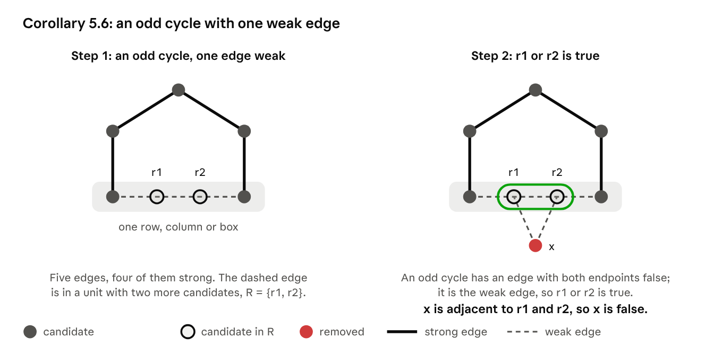

*Figure 22. Corollary 5.6 · guardians of an odd loop*

## 7. Step 6: Where it stops

**A loop of weak edges alone forces nothing.** Start from the empty grid, where every candidate is still possible. First a fact: every candidate is true in some solution. To see it, write r − 1 = 3q + m and c − 1 = 3s + n with q, m, s, n in {0, 1, 2}, and let G(r, c) be the digit with

```math
G(r,c) - 1 \equiv 3m + q + 3s + n \pmod 9 .
```

Along a row, 3s + n runs through 0 to 8. Down a column, 3m + q does. Inside a box, 3m + n does. Adding a constant modulo 9 keeps nine values different, so G is a completed grid. Renaming its digits puts any digit in any cell.

Now take the three 1s in the first three cells of row 1. They form a triangle of weak edges, an odd cycle. Yet each of them is true in some solution, so none can be eliminated.

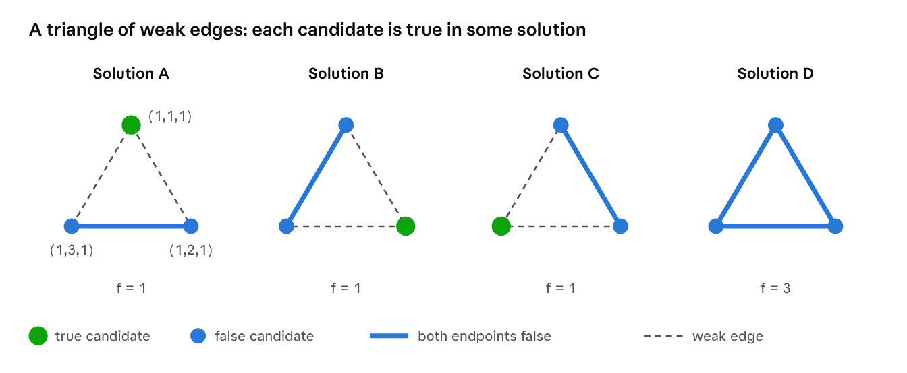

*Figure 23. three 1s in one row of the empty grid · four kinds of solution*

The Cycle Lemma is not broken here: the number of empty edges is odd every time. It just does not single out one candidate. Strong edges are what pin the answer down. Even loops are the same: four 1s in one row form a 4-cycle of weak edges and decide nothing.

**Some rules use a whole constraint set.** The last two 3D Medusa rules in \[8\] are of this kind.

**Proposition 7.1.** Let K0 be a color class of a component of the strong graph, and A a constraint set. If every candidate of A still in P is adjacent to some candidate of K0, then K0 is false and the other class is true.

*Why.* If K0 were true, every candidate of A would be false (Lemma 3.1). But a solution has a member in A. So K0 is not the true class, and by Theorem 5.1 the other one is. ∎

**How far can edges alone go?** Exactly as far as closed alternating walks. Call a true-or-false marking of P *edge-consistent* if it obeys both rules of Lemma 3.1 on every edge. Every solution is edge-consistent. An *alternating walk* from u is a sequence u = a(0), a(1), ..., a(n) whose steps are edges at even positions and strong edges at odd positions. Nodes may repeat. The walk is *closed* if n is odd, n ≥ 3 and it ends back at u.

**Proposition 7.2 (closed walks).**

1.  If a closed alternating walk starts at u, then u is false in every edge-consistent marking, and so in every solution.

2.  If none does, some edge-consistent marking makes u true.

A closed alternating walk with no repeated node is exactly the cycle of Theorem 5.2.

*Why, part 1.* Suppose u is true. An edge from a true candidate leads to a false one. A strong edge from a false candidate leads to a true one. So a(0), a(2), a(4), ... are all true, including a(n − 1). But a(n − 1) is adjacent to u, and both are true. Contradiction.

*Why, part 2.* Let E be the candidates reached from u by alternating walks of even length, u included. Let O be the candidates adjacent to some member of E.

1.  No two members of E are adjacent. If e and e′ were, walk from u to e, cross to e′, and return to u along the route to e′ reversed. The crossing is an even step, and the return has its strong edges at odd steps. That is a closed alternating walk, of length at least 3 because e and e′ differ. We assumed there is none. So E and O do not overlap.

2.  A strong edge from a member o of O leads into E. Extend the walk that reaches o's neighbor in E by o, and then by the strong partner of o.

3.  Take any solution T. Mark E true, O false, and everything else as in T.

4.  Check each edge pq. One end in E: the other is in O, and the total is 1. No end in E, one in O: the total is at most 1, and by point 2 the edge is not strong. Neither in E nor in O: these are T's values, fine by Lemma 3.1.

So the marking is edge-consistent and makes u true. ∎

In logic terms a weak edge is the clause "not p or not q", and a strong edge adds "p or q". Proposition 7.2 is the classical 2-SAT argument \[6\] in sudoku clothing.

**Proposition 7.3 (a deduction edges cannot reach).** In some state a candidate can be eliminated, although an edge-consistent marking makes it true.

*Why.* Take every candidate, except that the first three cells of row 1 keep only the digits 1, 2 and 3. The grid G fits, so a solution exists. In any solution those three cells hold 1, 2 and 3 in some order, so the 1 in cell 4 of row 1 is false.

Yet no constraint set has exactly two candidates left. The counts are 3 for the three special cells, 6 for digits 4 to 9 in row 1 and in box 1, 8 for digits 4 to 9 in columns 1 to 3, and 9 for the rest. So there is no strong edge, and marking that one candidate true and all others false is edge-consistent. ∎


*Figure 24. Proposition 7.3 · row 1 of the example state*

This is a *naked triple*. It counts three cells against three digits and never uses a strong edge.

So the method has a clear edge. Inside it: pairs, wings, kites, chains, loops and coloring. Outside it: naked and hidden triples, fish with three or more candidates in a line, XYZ-Wing, and chains that treat a group of cells as one node, such as the Empty Rectangle. Those need rules about three or more candidates at once. The next part supplies two of them.

### Going past the edge

The edge is not the end. The same two colors, true and false, reach further in two ways: make the nodes bigger, or count across whole constraint sets.

**1. Bigger nodes: a group as one candidate.** Take one digit, and two or three of its candidates in cells of one box that share a row or column. Call that a *group*. Color a group true when one of its members is true, and false when all of them are false. A single candidate is a group of one.

Two groups are *adjacent* when they share no candidate and some constraint set contains both. The edge is *strong* when together they are every candidate left in that set.

**Lemma 7.4 (groups obey the edge rules).** Let A and B be adjacent groups and T a solution. At most one of A, B is true. If the edge is strong, exactly one is.

*Why.* Both lie in one constraint set, which holds exactly one true candidate. That candidate cannot be in A and in B, because they share nothing. If A and B together are the whole set, it is in one of them. ∎

The Cycle Lemma and Theorem 5.2 used nothing about a node except these two rules. So both hold word for word when some nodes are groups. This covers:

- **Locked triple** (pointing or claiming with three cells). A digit has three places in one unit, all inside a second unit. The three form a group that is true in every solution, so every other candidate of that digit in the second unit is adjacent to a true node and is false.

- **Empty Rectangle** and **grouped X-Cycles**. These are odd loops of one digit in which one or more nodes are groups.


*Figure 25. A group as one node · a locked triple*

**2. Counting across sets.** Edges look at two candidates at a time. The next rule looks at whole constraint sets.

**Theorem 7.5 (the sets rule).** Let B1, ..., Bk be constraint sets that share no candidate with each other, and C1, ..., Ck be k constraint sets. Suppose every candidate still in the B's is also in some C. Then every candidate in the C's that is in no B is false in every solution.

*Why.* Each B holds exactly one true candidate, and the B's share nothing, so they hold k true candidates between them. Each of these lies in some C. A C holds only one true candidate, so the k true candidates lie in k different C's, one each. That uses up all k of the C's: each C has its one true candidate inside the B's. So a candidate of a C outside the B's is false. ∎

In colors: the k true candidates of the B's are exactly the k true candidates of the C's. Counting them twice is the whole proof, as counting round the loop was for the Cycle Lemma.

In nodes: for each C, the candidates it shares with the B's form one node, as a group did above, and the count proves that node true. Every other candidate of that C is adjacent to it, so it is false. The sets rule is the Locked triple again, with a count standing in for a single constraint set.

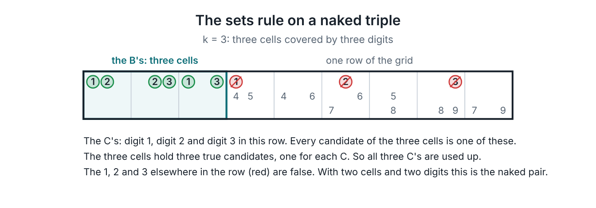

*Figure 26. The sets rule on a naked triple · k = 3*

There is a second graph behind this. Make every constraint set a node, and draw a candidate as an edge joining two sets it belongs to, for example its cell and its row-and-digit set. That graph is bipartite: cells on one side, row-and-digit sets on the other. A solution picks edges so that every node is used once, which graph theory calls a perfect matching. The sets rule is the counting behind Hall's theorem for that graph: k nodes on one side whose edges reach only k nodes on the other must be matched with exactly those.

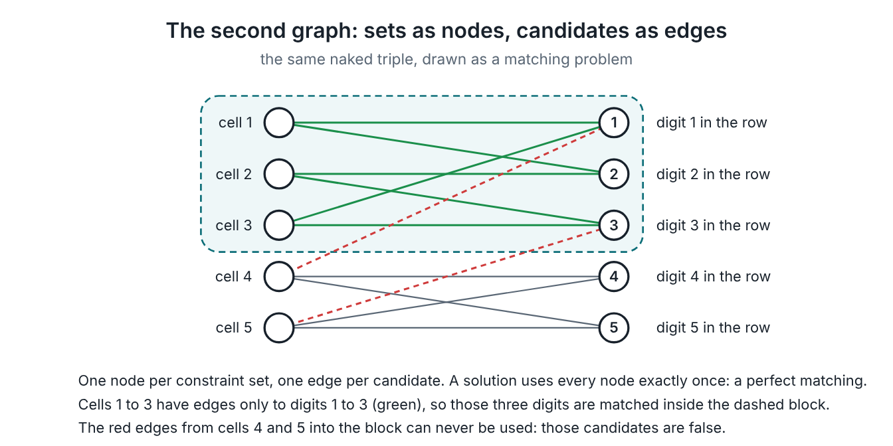

*Figure 27. The second graph · sets as nodes, candidates as edges*

What the sets rule covers:

| Strategy | The B's | The C's |
| --- | --- | --- |
| Naked pair, triple, quad | k cells of one unit | the k digits they hold, in that unit |
| Hidden pair, triple, quad | k digits in one unit | the k cells they fit in |
| X-Wing, Swordfish, Jellyfish | one digit in k rows | the same digit in k columns |

With k = 2 these are the naked pair, hidden pair and X-Wing of Theorem 5.4. So the 4-cycle with two strong edges is the smallest case of the sets rule, and the sets rule is where the even loop leads when a set has more than two candidates left. The naked triple of Proposition 7.3 is the case k = 3.

**3. An edge that has to be counted.** Theorem 5.2 never needed a strong edge to mean "exactly one". Its proof only used one direction: if this end is false, the other is true. So an edge that says "at least one of these is true" serves just as well, wherever it comes from.

**Lemma 7.6 (the XYZ edge).** Let a cell p hold x, y and z. Let it see a cell holding x and z, and a cell holding y and z. Then at least one of the three z's in those cells is true.

*Why.* The cell p is x, y or z. If it is x, the cell holding x and z sees it and must be z. If it is y, the cell holding y and z must be z. Otherwise p itself is z. ∎

So take the z in p and the z in the first wing as one node, and the z in the second wing as another. They cannot both be false. A candidate z that sees all three cells is adjacent to both nodes. Suppose it is true: both nodes are false, which the lemma forbids. That is the **XYZ-Wing**, and its shape is a triangle, like the Locked pair.

**Lemma 7.7 (the edge inside an almost-locked set).** Call n cells of one unit that hold n + 1 digits between them an *almost-locked set*: one digit too many. For each of its digits, the candidates of that digit in the set form a node. Then the nodes of two different digits cannot both be false.

*Why.* If both were false, the n cells would have only n − 1 digits left between them. Cells of one unit need different digits, so that is impossible. ∎

So an almost-locked set supplies counted edges between its own nodes. Nodes of the same digit in two different sets are adjacent in the ordinary way when all their cells see each other. That is everything Theorem 5.2 needs, so loops may now run through almost-locked sets:

- **Two sets (ALS-XZ, WXYZ-Wing, XYZ-Wing).** Sets A and B share a digit x whose places all see each other, and another digit z. The loop is: a candidate z that sees every z of both sets, the z node of A, the x node of A, the x node of B, the z node of B, and back. Suppose the candidate is true: both z nodes are false, so both x nodes are true, and they see each other.

- **Three or more sets (ALS-XY-Wing, chains of almost-locked sets).** The loop simply passes through more sets, changing digit each time.

- **Two sets with two connecting digits (this includes the basic Sue de Coq).** Each connecting digit is used by at most one set, which leaves no digit to spare, so every node of both sets is true.

**Finned fish** work the same way. Suppose a digit in k rows fits k columns except for a few extra places, the *fin*, all in one box. If every fin candidate is false, the sets rule applies and each column's node is true. So the fin node and a column's node cannot both be false. A candidate in that column and in the fin's box is adjacent to both, and the triangle closes.

**4. Two remarks.**

*Triples as a coloring.* A solved grid colors the 81 cells with nine colors so that cells which see each other differ \[2\]. A naked triple is three cells that all see each other and share a list of three colors, so they use up all three. The sets rule says the same thing by counting.

*The unique rectangle.* Four cells in two rows, two columns and two boxes, each holding only a and b, form an even loop, and an even loop has exactly two colorings (Corollary 2.2). Nothing outside the four cells can tell the two apart, so both would be solutions. A proper puzzle has one solution, so that pattern can never appear, and any candidate that would complete it is false. The loop and its two colorings are graph theory. The last step is not: it uses a fact about the puzzle that is not one of the 324 constraint sets.

All four were checked by brute force on about 1,100 random states that contain a known solution: 1.1 million adjacent pairs of group nodes against Lemma 7.4, about 17,000 instances of the sets rule with k = 2, 3 and 4, about 1,700 XYZ configurations against Lemma 7.6, and about 385,000 instances for almost-locked sets against Lemma 7.7. There were no failures. The script is `proofs/verify_sets.py`.

**What is still outside.** *Trial and error* reaches its contradiction through a branching web of consequences, not a loop, a coloring or a count. So do the few very rare patterns not examined here, such as the Exocet.

## 8. Has this been done before?

Yes, in pieces. The strategies are well known, and so is the loop view. What I have not found written down is one counting rule that proves all of them.

- **Sudoku as graph coloring.** Herzberg and Murty \[2\] color the 81 cells with nine digits. That graph describes what a solution is. It is not the candidate graph used here.

- **Bivalue and bilocation graphs.** Eppstein \[3\] builds graphs from the same strong edges and reads solving rules off their cycles. His rules use edge labels, not two colors or parity. This is the closest academic precedent.

- **Coloring.** HoDoKu \[7\] describes Simple Colors, with the names Color Trap and Color Wrap, and Multi Colors, whose two rules are Bridge and Double bridge here. SudokuWiki \[8\] describes 3D Medusa.

- **Loops.** SudokuWiki \[8\] notes that a loop with one discontinuity has an odd number of nodes, and states the rules proved here as Theorems 5.2 and 5.3. Sudopedia \[9\] has the rule that is Theorem 5.4. Barker \[10\] observes that an odd loop of strong edges cannot occur, and describes the guardians of the Broken Wing.

- **Background maths.** Theorem 2.1 is König's \[1\]. The odd-cycle bound is Padberg's \[4\]. The 2-SAT method is due to Aspvall, Plass and Tarjan \[6\]. Berthier \[11\] treats chains in formal logic.

## 9. Summary

1.  Candidates are nodes. "Not both" is an edge. "Exactly one" is a strong edge.

2.  Round any loop of k nodes, the empty edges number k − 2t.

3.  Strong edges are never empty, so they 2-color.

4.  Pair up a loop with strong edges and nothing is left to choose. An odd loop decides its leftover candidate; an even loop makes every edge either-or.

5.  More than a dozen named strategies are that one fact in different shapes.

6.  Triples and bigger fish need more than edges.

## References

1.  D. König, *Theorie der endlichen und unendlichen Graphen*, Akademische Verlagsgesellschaft, Leipzig, 1936.

2.  A. M. Herzberg and M. R. Murty, Sudoku squares and chromatic polynomials, *Notices of the American Mathematical Society* 54 (2007), no. 6, 708–717. Summary: [Plus Magazine](https://plus.maths.org/content/solving-sudokus-coloring-numbers).

3.  D. Eppstein, [Nonrepetitive paths and cycles in graphs with application to Sudoku](https://arxiv.org/abs/cs/0507053), arXiv:cs/0507053, 2005.

4.  M. W. Padberg, On the facial structure of set packing polyhedra, *Mathematical Programming* 5 (1973), 199–215.

5.  D. E. Knuth, Dancing edges, in *Millennial Perspectives in Computer Science*, Palgrave, 2000, 187–214. arXiv:cs/0011047.

6.  B. Aspvall, M. F. Plass and R. E. Tarjan, A linear-time algorithm for testing the truth of certain quantified Boolean formulas, *Information Processing Letters* 8 (1979), 121–123.

7.  B. Hobiger, [HoDoKu: Coloring techniques](https://hodoku.sourceforge.net/en/tech_col.php).

8.  A. Stuart, SudokuWiki: [X-Cycles, Part 2](https://www.sudokuwiki.org/X_Cycles_Part_2) and [3D Medusa](https://www.sudokuwiki.org/3D_Medusa).

9.  Sudopedia, [Nice Loop](https://sudopedia.sudocue.net/index.php/Nice_Loop).

10. A. Barker, [Odd Loops, Broken Wings, and Dark Logic](https://sudokuone.com/sweb/gen2/blacklog.htm).

11. D. Berthier, *The Hidden Logic of Sudoku*, Lulu, 2007.
